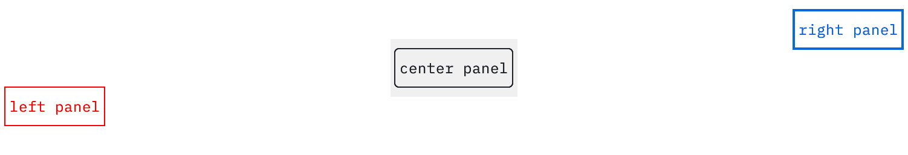
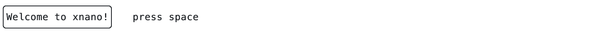
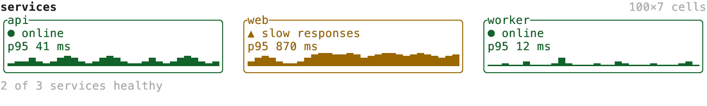
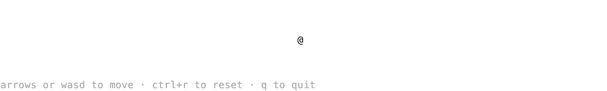
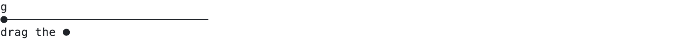
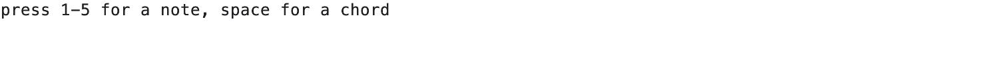
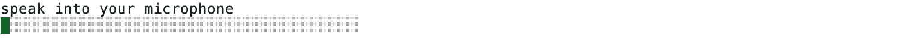
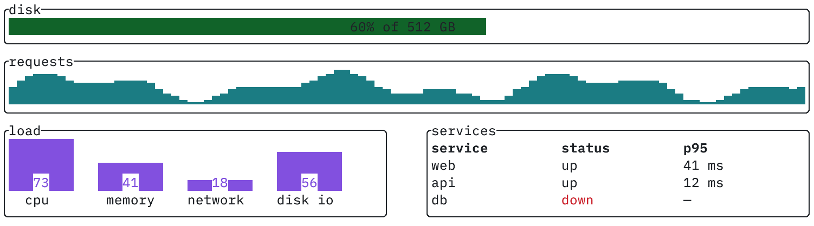
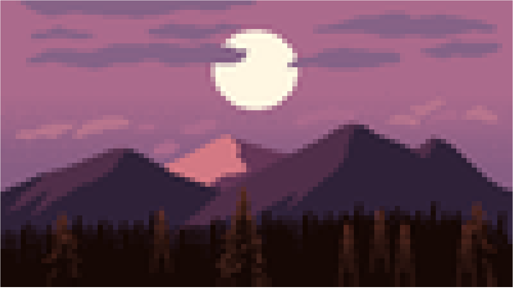

<!-- markdownlint-disable-next-line MD041 -->
> [!IMPORTANT]
> **v2!**
> `xnano` has recently gone through a complete rewrite that offers a much faster
> and more flexible API.
> However, due to the scale of the rewrite, there is no backwards compatibility
> with the previous version.
> You can find documentation and other information about `xnano`'s original grid
> & field based API in the [`v1
> branch`](https://github.com/hsaeed3/xnano/tree/v1).

<div align="center">

# **xnano**

An _extremely nano_ terminal experience for Python, built on [`ratatui`](https://ratatui.rs/).


[](https://pepy.tech/project/xnano)

[](https://app.codspeed.io/hsaeed3/xnano?utm_source=badge)
[](https://ratatui.rs/)

[Documentation (_Coming Soon_)](https://xnano.hammad.app) ·
[API Reference](https://xnano.hammad.app/api-reference/) ·
[Contribution Guide](./CONTRIBUTING.md)

</div>

---

`xnano` is a package for Python 3.10+ that aims to provide a complete terminal
framework through an incredibly flexible and understandable API.

With `xnano` you can:

- Render widgets, textual content, pixel art and even images in your terminal window.
- Add interactive hooks that respond to user input and actions at runtime.
- Compose, record & play audio with [`xnano-audio`](https://github.com/hsaeed3/xnano/tree/main/packages/xnano-audio).

## Installation

Install `xnano` from [PYPI](https://pypi.org/project/xnano):

```bash
pip install xnano
```

```bash
# With image support
pip install "xnano[image]"
```

```bash
# With audio support
pip install "xnano[audio]"
```

## Quick Start

<!-- @code-block name="click-to-change-color" type="gif" height=5
wait 0.5
click 55 2
wait 0.5
click 55 2
wait 0.5
click 55 2
wait 0.5
click 55 2
wait 0.5
click 55 2
wait 0.5
click 55 2
wait 0.5
-->
```python
import xnano

# Create a new canvas with `xnano.new()` & enable mouse events
# # Write content to the canvas with `canvas.write()`
canvas = xnano.new()
content = canvas.screen.write('Hello, world!', x='center', y='center')


# The canvas or any piece of content can register hooks.
# This hook is specific to the dimensions of the content itself!
@content.hook(on='mouse')
def change_color(ctx: xnano.Context):
    if ctx.mouse.button == 'left':
        content.color.fg = content.color.fg.random()


# now we can run our canvas in a live terminal
# `mouse=True` enables mouse events
with xnano.open(mouse=True) as terminal:
    terminal.screen.write(canvas)
    terminal.run(stop_on='q')
```

<!-- @code-block-asset name="click-to-change-color" -->
<picture>
  <source media="(prefers-color-scheme: dark)" srcset="docs/assets/readme/click-to-change-color-dark.gif">
  
</picture>
<!-- /@code-block-asset -->

## Core Features & Examples

<details>
<summary>Composing Content</summary>

The `Canvas` is a stateful builder class for composing a rectangular region
within a terminal `Screen`. Canvases can be used to define anything from a
simple header to a complex multi-window layout.

<!-- @code-block name="composing-content" type="image" height=8 -->
```python
import xnano

# `layout='row'` (or `'column'`) shares a canvas's space between everything written into it
body = xnano.new(height=7, width='100%', layout='row')
body.screen.write(
    'left panel', border='plain', x='left', y='bottom', foreground=(255, 0, 0)
)
body.screen.write(
    'center panel', border='rounded', x='center', y='center', background='#f0f0f0'
)
body.screen.write('right panel', border='thick', x='right', y='top', foreground='blue')

# a canvas has access to all devices a terminal does
# you can render a static frame of its screen and print it directly!
print(body.screen.render(format='ansi'))
```

<!-- @code-block-asset name="composing-content" -->
<picture>
  <source media="(prefers-color-scheme: dark)" srcset="docs/assets/readme/composing-content-dark.png">
  
</picture>
<!-- /@code-block-asset -->

</details>

<details>
<summary>Positioning & Sizing Content</summary>

`xnano` provides a collection of intuitive utilities and attributes that allow
you to dynamically position, move and resize the content within your terminal
window. Both audio and visual content follow a coordinate-based composition
pattern.

</details>

<details>
<summary>Styling Content</summary>

All of [`ratatui`'s styling](https://ratatui.rs/examples/style/) is natively
supported within `xnano`. This includes:

- [Background & foreground colors](https://ratatui.rs/examples/style/colors/)
  (RGB, HEX, ANSI, Tailwind, ...)
- [Text modifiers](https://ratatui.rs/examples/style/modifiers/) (bold, italic,
  underline, ...)
- [Borders & border styling](https://ratatui.rs/recipes/widgets/block/)

</details>

<details>
<summary>Terminal and Terminal Devices</summary>

The `Terminal` class is the main entrypoint for rendering **live** visual and
audio content. It provides a set of `Device`s that modularize the terminal's
capabilities. These classes include:

- `Clock`: The main requirement for any live terminal context. Allows
  controlling the tick, frame (FPS) and beat (BPM) rates for any live terminal
  context.
- `Screen`: A 2D canvas of cells that can render content to the terminal.
- `Keyboard` & `Mouse`: Allows capturing and emitting keyboard (key
  presses/clipboard paste) and mouse (click/drag/scroll) events.
- `Speaker`: `xnano`'s _'audio canvas'_ that provides a MIDI-based interface for
  composing and playing audio.  <small>(Requires `xnano-audio`)</small>
- `Microphone`: Allows capturing direct audio input from the system's
  microphone. <small>(Requires `xnano-audio`)</small>

<details>
<summary><strong>Terminal</strong></summary>

<!-- @code-block name="terminal" type="gif" height=3
wait 0.5
press space
wait 0.2
press space
wait 2.0
press space
wait 1.3
press space
wait 5.1
press space
wait 1.0
-->
```python
import xnano

# `xnano.open()` puts a live terminal on your screen: give it a `height` to draw in a
# region below your prompt, or leave it out to take over the whole window
with xnano.open(height=3, title='my app') as terminal:
    terminal.screen.write('Welcome to xnano!', border='rounded')
    label = terminal.screen.write('press space', x=22, y=1)

    # the terminal itself can register hooks, which hear every event on the screen
    @terminal.hook(on='key', keys='space')
    def pressed(ctx: xnano.Context):
        label.text = f'space at {ctx.clock.elapsed_seconds:.1f}s'

    # `run()` keeps the terminal alive until one of the `stop_on` keys is pressed
    terminal.run(stop_on='q')
```

<!-- @code-block-asset name="terminal" -->
<picture>
  <source media="(prefers-color-scheme: dark)" srcset="docs/assets/readme/terminal-dark.gif">
  
</picture>
<!-- /@code-block-asset -->
</details>

<details>
<summary><strong>Clock</strong></summary>

<!-- @code-block name="clock" type="gif" height=3
wait 4.5
press space
wait 2.5
press space
wait 4.5
-->
```python
import xnano

with xnano.open(height=3) as terminal:
    label = terminal.screen.write('')
    ball = terminal.screen.write('●', y=1)

    # the clock can be used directly in math, so the ball moves on every frame by itself
    ball.x = (terminal.clock * 10) % terminal.screen.width

    # tick hooks run on a timer, measured in seconds of the clock
    @terminal.hook(on='tick', every=1.0)
    def show_time(ctx: xnano.Context):
        label.text = f'{ctx.clock.elapsed_seconds:.0f}s on the clock'

    # `pause()` freezes everything that follows the clock, and `resume()` lets it run on
    @terminal.hook(on='key', keys='space')
    def toggle(ctx: xnano.Context):
        if ctx.clock.is_paused:
            ctx.clock.resume()
        else:
            ctx.clock.pause()
            label.text = 'paused: press space to resume'

    terminal.run(stop_on='q')
```

<!-- @code-block-asset name="clock" -->
<picture>
  <source media="(prefers-color-scheme: dark)" srcset="docs/assets/readme/clock-dark.gif">
  
</picture>
<!-- /@code-block-asset -->
</details>

<details>
<summary><strong>Screen</strong></summary>

<!-- @code-block name="screen" type="image" height=8 -->
```python
import xnano

# each service's response time, and its requests over the last 30 seconds
services = {
    'api': ('41 ms', '▂▃▃▅▃▂▃▅▆▅▃▂▃▅▆▅▃▂▂▃▅▃▂▃▅▆▅▃▂▃'),
    'web': ('870 ms', '▃▅▆▅▃▂▂▃▅▇██▇▇█▇▅▆▇██▇▆▇█▇▆▅▆▇'),
    'worker': ('12 ms', '▁▁▂▁▁▃▁▁▁▂▅▂▁▁▁▂▁▁▃▂▁▁▁▂▁▁▁▂▃▁'),
}

# a canvas from `xnano.new()` needs no live terminal: `width='100%'` fills the window
with xnano.new(width='100%', height=7) as canvas:
    screen = canvas.screen

    # positions and sizes take cells, percentages or words such as 'center' and 'right'
    screen.write('services', bold=True)
    screen.write(f'{screen.width}×{screen.height} cells', x='right', y=0, dim=True)

    cards = {}
    for index, (name, (latency, graph)) in enumerate(services.items()):
        cards[name] = screen.write(
            ['● online', f'p95 {latency}', graph],
            x=f'{index * 34}%',
            y=1,
            width='32%',
            border='rounded',
            title=name,
            foreground='green',
        )

    # `write()` returns a live placement: its text and colors can change at any time
    cards['web'].text = cards['web'].text.replace('● online', '▲ slow responses')
    cards['web'].color.fg = 'yellow'

    # and it can be read back, like any other value
    healthy = sum(card.text.startswith('●') for card in cards.values())
    screen.write(f'{healthy} of {len(cards)} services healthy', y='bottom', dim=True)

    print(screen.render(format='ansi'))
```

<!-- @code-block-asset name="screen" -->
<picture>
  <source media="(prefers-color-scheme: dark)" srcset="docs/assets/readme/screen-dark.png">
  
</picture>
<!-- /@code-block-asset -->
</details>

<details>
<summary><strong>Keyboard</strong></summary>

<!-- @code-block name="keyboard" type="gif" height=8
wait 0.8
press up
wait 0.08
press up
wait 0.08
press up
wait 0.08
press up
wait 0.08
wait 0.6
press right
wait 0.08
press right
wait 0.08
press right
wait 0.08
press right
wait 0.08
press right
wait 0.08
press right
wait 0.08
press right
wait 0.08
press right
wait 0.08
press right
wait 0.08
press right
wait 0.08
press right
wait 0.08
press right
wait 0.08
press right
wait 0.08
press right
wait 0.08
press right
wait 0.08
press right
wait 0.08
press right
wait 0.08
press right
wait 0.08
press right
wait 0.08
press right
wait 0.08
wait 0.6
press down
wait 0.08
press down
wait 0.08
press down
wait 0.08
wait 0.6
press left
wait 0.08
press left
wait 0.08
press left
wait 0.08
press left
wait 0.08
press left
wait 0.08
wait 0.6
press ctrl+r
wait 1.2
-->
```python
import xnano

# this stops any content within this terminal's canvas from moving outside it
with xnano.open(height=8, edges='stop') as terminal:
    player = terminal.screen.write('@', x='center', y='center')
    terminal.screen.write(
        'arrows or wasd to move · ctrl+r to reset · q to quit', y='bottom', dim=True
    )

    # `on='key'` hooks run on every key press, and again while a key repeats
    @terminal.hook(on='key')
    def move(ctx: xnano.Context):
        # `direction()` reads the arrow keys (or wasd) as a step along each axis
        step_x, step_y = ctx.keyboard.direction()
        player.move(step_x, step_y)

    # `keys=` narrows a hook to one key, or a binding with modifiers
    @terminal.hook(on='key', keys='ctrl+r')
    def reset(ctx: xnano.Context):
        player.x, player.y = 'center', 'center'

    terminal.run(stop_on='q')
```

<!-- @code-block-asset name="keyboard" -->
<picture>
  <source media="(prefers-color-scheme: dark)" srcset="docs/assets/readme/keyboard-dark.gif">
  
</picture>
<!-- /@code-block-asset -->
</details>

<details>
<summary><strong>Mouse</strong></summary>

<!-- @code-block name="mouse" type="gif" height=3
wait 0.8
drag 0 1 22 1
wait 1.2
drag 22 1 9 1
wait 1.5
-->
```python
import xnano

# `mouse=True` enables mouse events
with xnano.open(height=3, mouse=True) as terminal:
    terminal.screen.write('─' * 30, y=1)
    label = terminal.screen.write('drag the ●', y=2)

    # a range keeps the thumb's `x` between two columns, however far it's dragged
    thumb = terminal.screen.write('●', x=(0, 29), y=1)

    # a drag hook is a generator: each `yield` waits for the next movement of the pointer
    @thumb.hook(on='drag')
    def slide(ctx: xnano.Context):
        while ctx.mouse.is_down:
            thumb.x = ctx.parent.local(ctx.mouse.position).x
            ctx = yield
        label.text = f'dropped at {thumb.x}'

    terminal.run(stop_on='q')
```

<!-- @code-block-asset name="mouse" -->
<picture>
  <source media="(prefers-color-scheme: dark)" srcset="docs/assets/readme/mouse-dark.gif">
  
</picture>
<!-- /@code-block-asset -->
</details>

<details>
<summary><strong>Speaker</strong></summary>

<!-- @code-block name="speaker" type="gif" height=3
wait 2.2
press 1
wait 0.5
press 3
wait 0.5
press 5
wait 0.5
press space
wait 1.8
-->
```python
import xnano

# notes are plain values, so they can be defined once and played anywhere
scale = ['C4', 'D4', 'E4', 'G4', 'A4']
chord = xnano.Note(('C4', 'E4', 'G4'), beats=2, instrument='electric_piano')

with xnano.open(height=2) as terminal:
    terminal.screen.write('press 1-5 for a note, space for a chord')
    playing = terminal.screen.write('', y=1, foreground='cyan')

    @terminal.hook(on='key')
    def play_note(ctx: xnano.Context):
        key = ctx.keyboard.key
        if key in ('1', '2', '3', '4', '5'):
            pitch = scale[int(key) - 1]
            ctx.speaker.play(xnano.Note(pitch, beats=0.5))
            playing.text = f'♪ {pitch}'
        elif key == 'space':
            ctx.speaker.play(chord)
            playing.text = '♪ C4 E4 G4'

    # melodies can also be written as text: a pitch, and its length in beats after a `:`
    if terminal.speaker.is_available:
        terminal.speaker.play('C4 E4 G4:2', instrument='piano')
    terminal.run(stop_on='q')
```

<!-- @code-block-asset name="speaker" -->
<picture>
  <source media="(prefers-color-scheme: dark)" srcset="docs/assets/readme/speaker-dark.gif">
  
</picture>
<!-- /@code-block-asset -->
</details>

<details>
<summary><strong>Microphone</strong></summary>

<!-- @code-block name="microphone" type="image" height=3
wait 1.5
-->
```python
import xnano

with xnano.open(height=2) as terminal:
    terminal.screen.write('speak into your microphone')

    # `level` is an expression from 0.0 to 1.0, so content can follow it on every frame
    # (the default input device opens the first time a frame reads it)
    level = terminal.microphone.level
    terminal.screen.write('░' * 40, x=0, y=1, dim=True)
    terminal.screen.write(
        '█' * 40, x=0, y=1, width=level * 40 + 1, foreground='green', layer=1
    )

    terminal.run(stop_on='q')
```

<!-- @code-block-asset name="microphone" -->
<picture>
  <source media="(prefers-color-scheme: dark)" srcset="docs/assets/readme/microphone-dark.png">
  
</picture>
<!-- /@code-block-asset -->
</details>

</details>

<details>
<summary>Terminal Widgets _(from [Ratatui Widgets](https://ratatui.rs/concepts/widgets/)_</summary>

All of [`ratatui`'s standard widgets](https://ratatui.rs/recipes/widgets/)
(along with a few extras) are built into `xnano`:

<!-- @code-block name="widgets" type="image" height=13
wait 0.5
-->
```python
import math

import xnano
from xnano.styles import Style
from xnano.widgets import Bar, BarChart, Gauge, Sparkline, Table, TableCell, TableRow

# requests per second over the last 98 seconds
requests = [
    round(6 + 3 * math.sin(second / 5) + 2 * math.sin(second / 2)) for second in range(98)
]

with xnano.open(height=13) as terminal:
    # widgets are written (and sized) like any other content, borders and titles included
    terminal.screen.write(
        Gauge(0.6, label='60% of 512 GB', gauge_style=Style(foreground='green')),
        width='100%',
        border='rounded',
        title='disk',
    )
    terminal.screen.write(
        Sparkline(requests, style=Style(foreground='cyan')),
        width='100%',
        height=4,
        border='rounded',
        title='requests',
    )
    load = terminal.screen.write(
        BarChart(
            [
                Bar(73, label='cpu'),
                Bar(41, label='memory'),
                Bar(18, label='network'),
                Bar(56, label='disk io'),
            ],
            bar_width=8,
            bar_gap=3,
            bar_style=Style(foreground='magenta'),
        ),
        width='48%',
        height=6,
        border='rounded',
        title='load',
    )
    # a placement's position can be read back, so the table lines up with the chart
    terminal.screen.write(
        Table(
            [
                ['web', 'up', '41 ms'],
                ['api', 'up', '12 ms'],
                ['db', TableCell('down', style=Style(foreground='red')), '—'],
            ],
            header=TableRow(['service', 'status', 'p95'], style=Style(bold=True)),
        ),
        x='right',
        y=load.y,
        width='48%',
        height=6,
        border='rounded',
        title='services',
    )
    terminal.run(stop_on='q')
```

<!-- @code-block-asset name="widgets" -->
<picture>
  <source media="(prefers-color-scheme: dark)" srcset="docs/assets/readme/widgets-dark.png">
  
</picture>
<!-- /@code-block-asset -->

</details>

<details>
<summary>Images & Pixel Art</summary>

Pixel art is a first-class concept within the library, additionally complemented
by the `xnano-image` package which provides native image rendering (thanks to
[`ratatui-image`](https://github.com/ratatui/ratatui-image)).

### Pixel Art

### Images

You can render both static image content (`.png`, `.jpg`) as well as animated
files such as `.gif` with no extra effort.

First, ensure you have the `xnano-image` package installed which can be added
through one of the two commands:

```bash
pip install "xnano[image]"
```

```bash
pip install xnano-image
```

Now, you can simply load and directly print an image without even needing to
open a live `xnano` terminal context.

<!-- @code-block name="images" type="image" height=31 -->
```python
import pathlib

import xnano

# load a `.png`, `.jpg` or animated `.gif`, sized in terminal cells or a percentage
# (this picture ships with xnano, so the example runs anywhere: use any path of your own)
picture = xnano.load_image(
    pathlib.Path(xnano.__file__).parent / 'assets' / 'dusk.png', width='100%'
)

# `xnano.region()` draws content into cells without a terminal, so it can be printed as is
print(xnano.region(picture).render(format='ansi'))
```

<!-- @code-block-asset name="images" -->
<picture>
  <source media="(prefers-color-scheme: dark)" srcset="docs/assets/readme/images-dark.png">
  
</picture>
<!-- /@code-block-asset -->

</details>

<details>
  <summary>Audio</summary>
</details>
