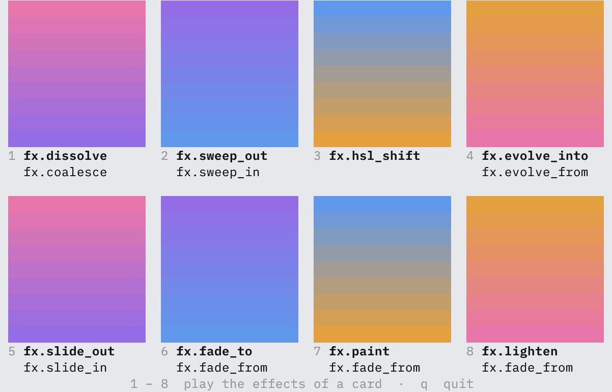
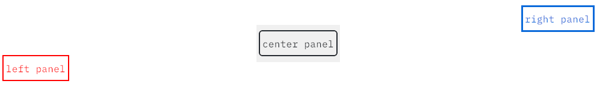
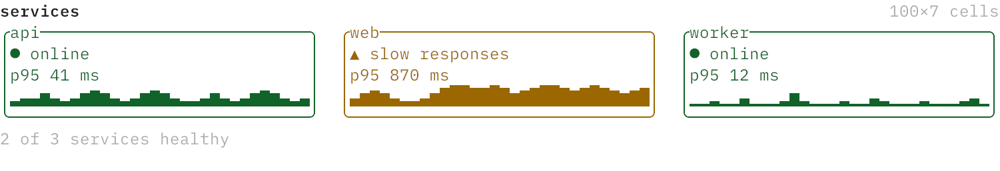
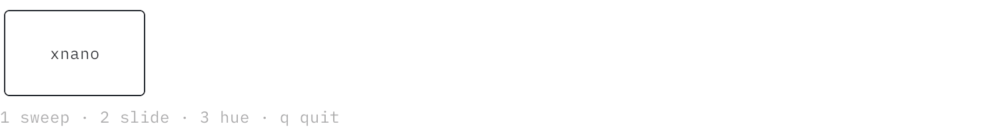
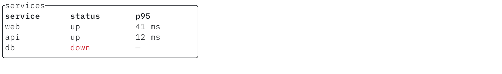
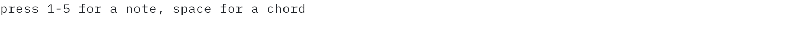
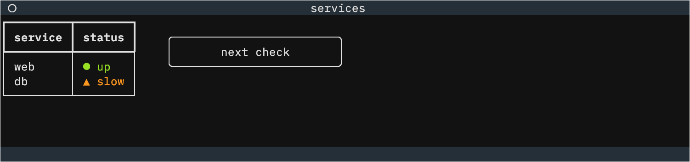

<!-- markdownlint-disable-next-line MD041 -->
<div align="center">

# **xnano**

An _extremely nano_ terminal experience for Python, built on [`ratatui`](https://ratatui.rs/).

[](./LICENSE)
[](https://pepy.tech/project/xnano)
[](https://pypi.org/project/xnano)
[](https://app.codspeed.io/hsaeed3/xnano?utm_source=badge)
[](https://ratatui.rs/)

[Documentation](https://xnano.hammad.app) ·
[Learn](https://xnano.hammad.app/learn/) ·
[API Reference](https://xnano.hammad.app/api-reference/) ·
[Examples](./examples) ·
[Contribution Guide](./CONTRIBUTING.md)

<picture>
  <source media="(prefers-color-scheme: dark)" srcset="docs/assets/home/effects-dark.gif">
  
</picture>

</div>

---

`xnano` is a terminal framework for Python. You write content anywhere on the
screen in one line, and what you wrote stays live: change its text, color or
position at any time, and the screen follows.

```python
import xnano

with xnano.open() as terminal:
    terminal.write('Hello, world!', x='center', y='center')
    terminal.run(stop_on='q')
```

## Try It

The demo shows the widgets, effects and input in one program. Run it without
installing anything, with [`uv`](https://docs.astral.sh/uv/):

```bash
uvx xnano
```

Pictures and sound are optional extras. To see and hear them in the demo:

```bash
uvx --from "xnano[image,audio]" xnano
```

Or install `xnano` and run the same demo:

```bash
pip install xnano
```

```bash
python -m xnano
```

## Why xnano

Most terminal libraries ask you to learn their structure first: an application
class, a tree of widgets, a layout language. `xnano` starts from one idea. You
write something on the screen, and you get back an object that you can change.

- **You write, and it shows.** [`terminal.write()`][learn-content] takes text,
  a [widget][learn-widgets], pixel art or an [image][learn-images]. You say
  where it goes with a number, a percentage, or a word such as `'center'`.
- **What you wrote stays live.** `write()` returns a [placement][api-layout].
  Set its `text`, its [`color`][learn-styling] or its `x`, and the screen
  changes with it. You never redraw the screen yourself.
- **A hook is a function.** A [hook][learn-input] runs your function on a key,
  a click, or a tick of the [clock][learn-time]. Put it on the whole screen, or
  on one placement so that it only hears its own cells.
- **A canvas does not need a terminal.** [`xnano.open()`][api-terminal] takes
  over the window, or a few rows below your prompt. [`xnano.new()`][api-canvas]
  makes the same canvas in memory, so you can print it, test it, or put it in
  another program.
- **Motion, sound and pictures are included.** [Effects][learn-time] such as
  fades and sweeps, [notes and melodies][learn-sound], and `.png`, `.jpg`,
  `.gif` and `.webp` files work the same way as text does.
- **The drawing is done in Rust.** Layout and drawing run in
  [`ratatui`](https://ratatui.rs/), so a frame stays fast when the screen is
  full. `make compare` times `xnano` against `rich`, `urwid` and
  `prompt_toolkit` on the same jobs.
- **It works with what you already use.** A canvas goes into a `rich` `Panel`
  or a `textual` `Static` as it is, and `rich` renderables go into a canvas. See
  [`rich` and `textual` users](#rich-and-textual-users).

[learn-content]: https://xnano.hammad.app/learn/content/
[learn-widgets]: https://xnano.hammad.app/learn/widgets/
[learn-images]: https://xnano.hammad.app/learn/images/
[learn-styling]: https://xnano.hammad.app/learn/styling/
[learn-input]: https://xnano.hammad.app/learn/input/
[learn-time]: https://xnano.hammad.app/learn/time/
[learn-sound]: https://xnano.hammad.app/learn/sound/
[learn-run]: https://xnano.hammad.app/learn/input/#end-a-run-and-keep-the-terminal
[api-layout]: https://xnano.hammad.app/api-reference/xnano/layout/
[api-terminal]: https://xnano.hammad.app/api-reference/xnano/terminal/
[api-canvas]: https://xnano.hammad.app/api-reference/xnano/canvas/

## Installation

```bash
pip install xnano
```

### Supported platforms

- **Python**: 3.10 to 3.14.
- **Linux**: x86_64 and aarch64, with glibc or musl.
- **macOS**: Intel and Apple silicon.
- **Windows**: x86_64.
- **WebAssembly**: [Pyodide](https://pyodide.org/), in a browser. A browser has no
  terminal, so a canvas from `xnano.new()` draws into memory there, and images and
  sound are not available.

Every platform has pre-built wheels, so you do not need a Rust toolchain.

### Optional extras

Images and sound are optional extras. When you use a feature whose extra is missing,
`xnano` tells you which one to install.

```bash
pip install "xnano[image]"  # pictures: .png, .jpg, .gif, .webp
```

```bash
pip install "xnano[audio]"  # sound: the speaker and the microphone
```

On Linux, playing sound on a device needs ALSA (`libasound`). Composing and rendering
sound work without a device everywhere.

## Quick Start

### Write to the terminal

Create a file `main.py` with:

<!-- @code-block name="hello-world" type="image" height=5 -->
```python
import xnano

with xnano.open() as terminal:
    terminal.write('Hello, world!', x='center', y='center')
    terminal.run(stop_on='q')
```

<!-- @code-block-asset name="hello-world" -->
<picture>
  <source media="(prefers-color-scheme: dark)" srcset="docs/assets/readme/hello-world-dark.png">
  
</picture>
<!-- /@code-block-asset -->

Run it with `python main.py`. `Hello, world!` appears in the middle of your
terminal window, and stays there until you press `q`. The program:

- opens a live terminal with `xnano.open()`, which takes over the whole window
  (give it a `height` to draw in a region below your prompt instead),
- writes text with `terminal.write()`, at a position such as `'center'`,
- keeps running with `terminal.run()` until one of its `stop_on` keys is pressed.

### React to input

Now make the text change color when you click it:

<!-- @code-block name="click-to-change-color" type="gif" height=5
wait 0.5
click 55 2
wait 0.5
click 55 2
wait 0.5
click 55 2
wait 0.5
click 55 2
wait 0.5
click 55 2
wait 0.5
click 55 2
wait 0.5
-->
```python
import xnano

# `mouse=True` turns on mouse events
with xnano.open(mouse=True) as terminal:
    greeting = terminal.write('Hello, world!', x='center', y='center')

    # a hook runs a function when something happens, and a hook on a placement only
    # hears the events inside its own cells
    @greeting.hook(on='mouse')
    def change_color(context: xnano.Context):
        # the button is down from the press to the release: a click gives one new color,
        # and a drag across the text gives a new color at every step
        if context.mouse.is_down:
            greeting.color.fg.random()

    terminal.run(stop_on='q')
```

<!-- @code-block-asset name="click-to-change-color" -->
<picture>
  <source media="(prefers-color-scheme: dark)" srcset="docs/assets/readme/click-to-change-color-dark.gif">
  
</picture>
<!-- /@code-block-asset -->

### Move from one screen to the next

[`terminal.run()`][learn-run] can return while the terminal stays open, so a
program can have several steps. A key of `end_on` ends the run, and so does
`end_run()` from a hook. A key of `stop_on` stops the terminal itself, and
`terminal.is_running` tells the two apart.

```python
import xnano

with xnano.open(height=3) as terminal:
    message = terminal.write('press enter to start', x='center', y='center')

    # `enter` ends this run: the terminal stays open, and the program goes on
    terminal.run(stop_on='q', end_on='enter')

    # after `q` the terminal is closed, so only go on while it is running
    if terminal.is_running:
        message.text = 'started: press q to quit'
        terminal.run(stop_on='q')
```

## Features

Every example below is a complete program: copy it into a file and run it. Press
`q` to leave the live ones. The [Learn guides](https://xnano.hammad.app/learn/)
cover each feature step by step.

### Layout

Positions and sizes take a number of cells, a percentage, or a word such as
`'center'` or `'bottom'`. Percentages and words are kept, so content stays where
you put it when the window changes. A canvas from `xnano.new()` draws into memory,
so it can be printed without a live terminal.
[Learn more](https://xnano.hammad.app/learn/content/).

<!-- @code-block name="composing-content" type="image" height=8 -->
```python
import xnano

# `layout='row'` gives everything written on the canvas an equal share of its width,
# and `x` and `y` place each piece inside its own share
with xnano.new(width='100%', height=7, layout='row') as canvas:
    canvas.write(
        'left panel', x='left', y='bottom', border='plain', foreground=(255, 0, 0)
    )
    canvas.write(
        'center panel',
        x='center',
        y='center',
        border='rounded',
        foreground='black',
        background='#f0f0f0',
    )
    canvas.write('right panel', x='right', y='top', border='thick', foreground='blue')

    # render one frame of the screen as colored text, and print it
    print(canvas.render(format='ansi'))
```

<!-- @code-block-asset name="composing-content" -->
<picture>
  <source media="(prefers-color-scheme: dark)" srcset="docs/assets/readme/composing-content-dark.png">
  
</picture>
<!-- /@code-block-asset -->

### Live content

`write()` returns a placement whose text and colors you can read and change at
any time. [Learn more](https://xnano.hammad.app/learn/styling/).

<!-- @code-block name="screen" type="image" height=8 -->
```python
import xnano

# each service's response time, and its requests over the last 30 seconds
services = {
    'api': ('41 ms', '▂▃▃▅▃▂▃▅▆▅▃▂▃▅▆▅▃▂▂▃▅▃▂▃▅▆▅▃▂▃'),
    'web': ('870 ms', '▃▅▆▅▃▂▂▃▅▇██▇▇█▇▅▆▇██▇▆▇█▇▆▅▆▇'),
    'worker': ('12 ms', '▁▁▂▁▁▃▁▁▁▂▅▂▁▁▁▂▁▁▃▂▁▁▁▂▁▁▁▂▃▁'),
}

# a canvas from `xnano.new()` needs no live terminal: `width='100%'` fills the window
with xnano.new(width='100%', height=7) as canvas:
    screen = canvas.screen
    screen.write('services', bold=True)
    screen.write(f'{screen.width}×{screen.height} cells', x='right', y=0, dim=True)

    cards = {}
    for index, (name, (latency, graph)) in enumerate(services.items()):
        cards[name] = screen.write(
            ['● online', f'p95 {latency}', graph],
            x=f'{index * 34}%',
            y=1,
            width='32%',
            border='rounded',
            title=name,
            foreground='green',
        )

    # `write()` returns a live placement: its text and colors can change at any time
    cards['web'].text = cards['web'].text.replace('● online', '▲ slow responses')
    cards['web'].color.fg = 'yellow'

    # and they can be read back, like any other value
    healthy = sum(card.text.startswith('●') for card in cards.values())
    screen.write(f'{healthy} of {len(cards)} services healthy', y='bottom', dim=True)

    print(screen.render(format='ansi'))
```

<!-- @code-block-asset name="screen" -->
<picture>
  <source media="(prefers-color-scheme: dark)" srcset="docs/assets/readme/screen-dark.png">
  
</picture>
<!-- /@code-block-asset -->

### Effects

Every placement has `fx`, with one method for each effect of
[`tachyonfx`](https://github.com/ratatui/tachyonfx). Effects run on the clock of
the terminal, so they pause when it pauses.
[Learn more](https://xnano.hammad.app/learn/time/).

<!-- @code-block name="animations" type="gif" height=6
wait 2.6
press 1
wait 1.0
press 2
wait 1.2
-->
```python
import xnano

with xnano.open(height=6) as terminal:
    card = terminal.write(
        'xnano',
        border='rounded',
        padding={'horizontal': 4, 'vertical': 1},
        foreground='magenta',
    )
    hint = terminal.write('loading...', y='bottom', dim=True)

    # an effect follows the terminal's clock, and without a duration it takes half a
    # second: one call starts it
    @terminal.hook(on='key', keys='1')
    def sweep(context: xnano.Context):
        card.fx.sweep_in(color='cyan')

    @terminal.hook(on='key', keys='2')
    def slide(context: xnano.Context):
        card.fx.slide_in(direction='left_to_right')

    # an effect is also a `with` block: it lasts as long as the block, and its duration
    # is only the longest that it can last. The hue shifts while the work is done
    with card.fx.hsl_shift(foreground=(360, 0, 0), duration_milliseconds=60_000):
        terminal.clock.sleep(2)  # your slow work goes here

    hint.text = '1 sweep · 2 slide · q quit'
    terminal.run(stop_on='q')
```

<!-- @code-block-asset name="animations" -->
<picture>
  <source media="(prefers-color-scheme: dark)" srcset="docs/assets/readme/animations-dark.gif">
  
</picture>
<!-- /@code-block-asset -->

### Widgets

All of `ratatui`'s widgets are in `xnano.widgets`: `BarChart`, `Block`,
`Calendar`, `Chart`, `Figure`, `Gauge`, `ItemList`, `LineGauge`, `Paragraph`,
`Scrollbar`, `Sparkline`, `Table` and `Tabs`. Each one is written like text.
[See every widget](https://xnano.hammad.app/learn/widgets/).

<!-- @code-block name="widget-table" type="image" height=7 -->
```python
import xnano
from xnano.styles import Style
from xnano.widgets import Table, TableCell, TableRow

table = Table(
    [
        ['web', 'up', '41 ms'],
        ['api', 'up', '12 ms'],
        ['db', TableCell('down', style=Style(foreground='red')), '—'],
    ],
    header=TableRow(['service', 'status', 'p95'], style=Style(bold=True)),
)

with xnano.new(width=40, height=6) as canvas:
    canvas.write(table, width='100%', height='100%', border='rounded', title='services')
    print(canvas.render(format='ansi'))
```

<!-- @code-block-asset name="widget-table" -->
<picture>
  <source media="(prefers-color-scheme: dark)" srcset="docs/assets/readme/widget-table-dark.png">
  
</picture>
<!-- /@code-block-asset -->

### Pixel art and images

Pixel art is written as text in your code with `xnano.pixel_art()`. Pictures are
loaded from files with `xnano.load_image()`.
[Learn more](https://xnano.hammad.app/learn/images/).

<!-- @code-block name="pixel-art" type="image" height=6 -->
```python
import xnano

# each character is one pixel: the palette names the colors, and `.` is see-through
heart = xnano.pixel_art(
    """
    ..RR...RR..
    .RWWR.RRRR.
    RRWRRRRRRRR
    RRRRRRRRRRR
    .RRRRRRRRR.
    ..RRRRRRR..
    ...RRRRR...
    ....RRR....
    .....R.....
    """,
    'R=#e03040 W=#ffffff',
)

# two pixels fit in one cell, one above the other, so the heart takes 11 by 5 cells
print(xnano.region(heart).render(format='ansi'))
```

<!-- @code-block-asset name="pixel-art" -->
<picture>
  <source media="(prefers-color-scheme: dark)" srcset="docs/assets/readme/pixel-art-dark.png">
  
</picture>
<!-- /@code-block-asset -->

### Sound

Notes and melodies are plain values. A live terminal plays them through its
speaker, and outside one, `xnano.play()` plays them through your computer's
sound output. [Learn more](https://xnano.hammad.app/learn/sound/).

<!-- @code-block name="speaker" type="gif" height=3
wait 2.2
press 1
wait 0.5
press 3
wait 0.5
press 5
wait 0.5
press space
wait 1.8
-->
```python
import xnano

scale = ['C4', 'D4', 'E4', 'G4', 'A4']
chord = xnano.Note(('C4', 'E4', 'G4'), beats=2, instrument='electric_piano')

with xnano.open(height=2) as terminal:
    terminal.write('press 1-5 for a note, space for a chord')
    playing = terminal.write('', y=1, foreground='cyan')

    @terminal.hook(on='key')
    def play_note(context: xnano.Context):
        key = context.keyboard.key
        if key in ('1', '2', '3', '4', '5'):
            pitch = scale[int(key) - 1]
            playing.text = f'♪ {pitch}'
            note = xnano.Note(pitch, beats=0.5)
        elif key == 'space':
            playing.text = '♪ C4 E4 G4'
            note = chord
        else:
            return
        # a computer without a sound output device (over SSH, for example) only shows it
        if context.speaker.is_available:
            context.speaker.play(note)

    # a melody can also be written as text: a pitch, and its length in beats after a `:`
    if terminal.speaker.is_available:
        terminal.speaker.play('C4 E4 G4:2', instrument='piano')
    terminal.run(stop_on='q')
```

<!-- @code-block-asset name="speaker" -->
<picture>
  <source media="(prefers-color-scheme: dark)" srcset="docs/assets/readme/speaker-dark.gif">
  
</picture>
<!-- /@code-block-asset -->

### More

- **Keyboard and mouse**: held keys, bindings such as `'ctrl+s'`, drags,
  scrolls and pasted text. [Hooks & Input](https://xnano.hammad.app/learn/input/).
- **The clock**: positions that follow the time, timers, a tempo in `bpm` and
  pausing. [Time & Effects](https://xnano.hammad.app/learn/time/).
- **The microphone**: the level of the sound coming in.
  [Sound](https://xnano.hammad.app/learn/sound/).
- **Models**: streaming text and decisions from a language model, in
  [`xnano.ai`](https://xnano.hammad.app/api-reference/xnano/ai/).

## Examples

[`examples/`](./examples) holds complete programs to read and run:

| Program | What it shows |
| --- | --- |
| `01_rhythm_circles.py` to `04_rhythm_lanes.py` | Four rhythm games, with pixel art and sound. |
| `05_dashboard.py` | A service dashboard that updates every second. |
| `06_form.py` | A form with three steps, each one a run that `enter` ends. |
| `07_file_picker.py` | A list of files to move through and open. |
| `08_log_viewer.py` | A log that follows new lines, scrolls back and filters by level. |

```bash
python examples/05_dashboard.py
```

## `rich` and `textual` users

`xnano` works with [`rich`](https://github.com/Textualize/rich) and
[`textual`](https://github.com/Textualize/textual) without an adapter. A canvas
is a `rich` renderable, so `rich.print()`, a `rich` `Panel` and a `textual`
`Static` show it as it is. In the other direction, `xnano.from_rich()` writes a
`rich` renderable, or `rich` markup, on a canvas.

This application has all three on one screen. `rich` makes the table, `xnano`
puts it on a canvas beside a gauge that follows the clock, and `textual` shows
the canvas between its own header and footer:

<!-- @code-block name="textual" type="gif" height=11
wait 5.5
-->
```python
import xnano
from rich.table import Table
from textual.app import App, ComposeResult
from textual.widgets import Footer, Header, Static
from xnano.widgets import Gauge


# rich: any renderable, such as this table with rich markup in its cells
def services() -> Table:
    table = Table('service', 'status')
    table.add_row('web', '[green]● up[/green]')
    table.add_row('db', '[yellow]▲ slow[/yellow]')
    return table


# xnano: a canvas holds the rich table beside a gauge that follows the canvas's clock
def dashboard() -> xnano.Canvas:
    canvas = xnano.new(width=50, height=6)
    canvas.write(xnano.from_rich(services()))
    check = Gauge(canvas.clock % 5 / 5, label='next check')
    canvas.write(check, x=24, y=1, width=26, height=3, border='rounded')
    return canvas


# textual: a `Static` shows the canvas as it is, between a header and a footer
class Services(App):
    TITLE = 'services'
    BINDINGS = [('q', 'quit', 'Quit')]

    def compose(self) -> ComposeResult:
        self.canvas = dashboard()
        yield Header()
        yield Static(self.canvas)
        yield Footer()

    def on_mount(self) -> None:
        # textual keeps the time: it moves the xnano clock and shows the canvas again
        self.set_interval(0.1, self.tick)

    def tick(self) -> None:
        self.canvas.clock.step(delta_seconds=0.1)
        self.query_one(Static).update(self.canvas)


if __name__ == '__main__':
    Services().run()
```

<!-- @code-block-asset name="textual" -->
<picture>
  <source media="(prefers-color-scheme: dark)" srcset="docs/assets/readme/textual-dark.gif">
  
</picture>
<!-- /@code-block-asset -->

The same canvas prints with `rich.print(dashboard())`. Make a canvas for
`textual` outside a `with` block, so it stays open: `textual` draws the `Static`
after it is made. To write text that has ANSI color codes, such as the output
of a command, use `StyledText.from_ansi()`.

## Learn More

- [Documentation](https://xnano.hammad.app): the documentation site.
- [Learn](https://xnano.hammad.app/learn/): a step-by-step introduction.
- [API Reference](https://xnano.hammad.app/api-reference/): every public module,
  class and function.
- [Contribution Guide](./CONTRIBUTING.md): how to set up the development
  workspace, make changes and open a pull request.

`xnano` 2 is a rewrite, and it does not run code written for version 1. The
documentation of the original grid and field API is in the
[`v1` branch](https://github.com/hsaeed3/xnano/tree/v1).

`xnano` is released under the [MIT License](./LICENSE).
