<!-- markdownlint-disable-next-line MD041 -->
> [!IMPORTANT]
> **v2!**
> `xnano` has been rewritten from the ground up, with a much faster and more
> flexible API. The rewrite is not backwards compatible with the previous
> version: the documentation of `xnano`'s original grid & field based API lives
> in the [`v1` branch](https://github.com/hsaeed3/xnano/tree/v1).

<div align="center">

# **xnano**

An _extremely nano_ terminal experience for Python, built on [`ratatui`](https://ratatui.rs/).

[](./LICENSE)
[](https://pepy.tech/project/xnano)
[](https://pypi.org/project/xnano)
[](https://app.codspeed.io/hsaeed3/xnano?utm_source=badge)
[](https://ratatui.rs/)

[Documentation](https://xnano.hammad.app) ·
[Learn](https://xnano.hammad.app/learn/) ·
[API Reference](https://xnano.hammad.app/api-reference/) ·
[Contribution Guide](./CONTRIBUTING.md)

</div>

---

`xnano` is a terminal framework for Python, with an API that is quick to learn and
flexible enough to grow with your program. With `xnano` you can:

- **Draw** text, widgets, pixel art and images anywhere in your terminal window.
- **React** to keys, the mouse and the clock with hooks.
- **Play** notes and melodies, and listen to the microphone, with
  [`xnano-audio`](https://github.com/hsaeed3/xnano/tree/main/packages/xnano-audio).
- **Build without a terminal**: a canvas from `xnano.new()` draws into memory,
  so you can print it, test it, and show it on the screen when you are ready.

## Requirements

- Python 3.10 to 3.14.
- Linux (x86_64 or aarch64, glibc or musl), macOS (Intel or Apple silicon) or Windows
  (x86_64). Each of these has pre-built wheels, so no Rust toolchain is needed.

## Installation

Install `xnano` from [PyPI](https://pypi.org/project/xnano):

```bash
pip install xnano
```

Images and sound are optional extras. When you use a feature whose extra is missing,
`xnano` tells you which one to install.

```bash
pip install "xnano[image]"  # pictures: .png, .jpg, .gif, .webp
pip install "xnano[audio]"  # sound: the speaker and the microphone
```

On Linux, playing sound on a device needs ALSA (`libasound`). Composing and rendering
sound work without a device everywhere.

## Table of Contents

1. [Quick Start](#quick-start)
   1. [Write to the Terminal](#write-some-stuff-to-the-terminal)
   2. [Adding Interactivity](#adding-interactivity)
2. [Core Features](#core-features--examples)
   1. [Composing Content](#composing-content)
   2. [Positioning & Sizing Content](#positioning--sizing-content)
   3. [Styling Content](#styling-content)
   4. [Terminal & Terminal Devices](#terminal-and-terminal-devices)
      1. [Terminal](#terminal)
      2. [Clock](#clock)
      3. [Screen](#screen)
      4. [Keyboard](#keyboard)
      5. [Mouse](#mouse)
      6. [Speaker (Audio & Virtual Instruments)](#speaker-audio--virtual-instruments)
      7. [Microphone](#microphone)
   5. [Built-in Terminal Widgets](#built-in-terminal-widgets-from-ratatui)
      1. [Bar Chart](#bar-chart)
      2. [Block](#block)
      3. [Calendar](#calendar)
      4. [Chart](#chart)
      5. [Figure](#figure)
      6. [Gauge](#gauge)
      7. [Item List](#item-list)
      8. [Line Gauge](#line-gauge)
      9. [Paragraph](#paragraph)
      10. [Scrollbar](#scrollbar)
      11. [Sparkline](#sparkline)
      12. [Table](#table)
      13. [Tabs](#tabs)
   6. [Images & Pixel Art](#images--pixel-art)
      1. [Pixel Art](#pixel-art)
      2. [Images](#images)
   7. [Animations](#animations)
   8. [AI](#ai)
      1. [Streaming Text](#streaming-text)
      2. [Making Decisions](#making-decisions)
3. [`rich` & `textual` Compatibility](#rich-and-textual-users)
   1. [`rich`](#rich)
   2. [`textual`](#textual)
4. [Learn More](#learn-more)

## Quick Start

### Write some stuff to the terminal

Create a file `main.py` with:

<!-- @code-block name="hello-world" type="image" height=5 -->
```python
import xnano

with xnano.open() as terminal:
    terminal.write('Hello, world!', x='center', y='center')
    terminal.run(stop_on='q')
```

<!-- @code-block-asset name="hello-world" -->
<picture>
  <source media="(prefers-color-scheme: dark)" srcset="docs/assets/readme/hello-world-dark.png">
  
</picture>
<!-- /@code-block-asset -->

### Run it

```bash
python main.py
```

`Hello, world!` appears in the middle of your terminal window, and stays there
until you press `q`. You already have a program that:

- opens a live terminal with `xnano.open()`, which takes over the whole window
  (give it a `height` to draw in a region below your prompt instead),
- writes text with `terminal.write()`, at a position such as `'center'`,
- keeps running with `terminal.run()` until one of its `stop_on` keys is pressed.

### Adding interactivity

Now make the text change color when you click it. Update `main.py`:

<!-- @code-block name="click-to-change-color" type="gif" height=5
wait 0.5
click 55 2
wait 0.5
click 55 2
wait 0.5
click 55 2
wait 0.5
click 55 2
wait 0.5
click 55 2
wait 0.5
click 55 2
wait 0.5
-->
```python
import xnano

# `mouse=True` turns on mouse events
with xnano.open(mouse=True) as terminal:
    greeting = terminal.write('Hello, world!', x='center', y='center')

    # a hook runs a function when something happens, and a hook on a placement only
    # hears the events inside its own cells
    @greeting.hook(on='mouse')
    def change_color(context: xnano.Context):
        # a click is a press and then a release: change the color once, on the press
        if context.mouse.kind == 'press':
            greeting.color.fg.random()

    terminal.run(stop_on='q')
```

<!-- @code-block-asset name="click-to-change-color" -->
<picture>
  <source media="(prefers-color-scheme: dark)" srcset="docs/assets/readme/click-to-change-color-dark.gif">
  
</picture>
<!-- /@code-block-asset -->

Run `python main.py` again and click `Hello, world!`: every click gives it a new
color.

## Core Features & Examples

Every example below is a complete program: copy it into a file and run it. Press
`q` to leave the live ones.

### Composing Content

The `Canvas` is a stateful builder for a rectangular region of a terminal
screen, from a one-line header to a multi-window layout. A canvas from
`xnano.new()` draws into memory, so it can be printed without a live terminal.

<!-- @code-block name="composing-content" type="image" height=8 -->
```python
import xnano

# `layout='row'` gives everything written on the canvas an equal share of its width,
# and `x` and `y` place each piece inside its own share
with xnano.new(width='100%', height=7, layout='row') as canvas:
    canvas.write(
        'left panel', x='left', y='bottom', border='plain', foreground=(255, 0, 0)
    )
    canvas.write(
        'center panel',
        x='center',
        y='center',
        border='rounded',
        foreground='black',
        background='#f0f0f0',
    )
    canvas.write(
        'right panel', x='right', y='top', border='thick', foreground='blue'
    )

    # render one frame of the screen as colored text, and print it
    print(canvas.render(format='ansi'))
```

<!-- @code-block-asset name="composing-content" -->
<picture>
  <source media="(prefers-color-scheme: dark)" srcset="docs/assets/readme/composing-content-dark.png">
  
</picture>
<!-- /@code-block-asset -->

### Positioning & Sizing Content

Positions and sizes all take the same forms: a number of cells, a percentage of
the space around the content, or a word such as `'center'` or `'bottom'`.
Percentages and words are kept, not computed once, so content stays where you
put it when the window or the content changes. Positions can also be expressions
that change on every frame (see the **Clock** example) or ranges that limit how
far content can move (see the **Mouse** example).

<!-- @code-block name="positioning-and-sizing" type="image" height=8 -->
```python
import xnano

with xnano.new(width='100%', height=7) as canvas:
    # content written without a position goes on the next line, the way a terminal prints
    canvas.write('first line')
    canvas.write('second line')

    # a position or a size is a number of cells, a percentage or a word
    canvas.write('x=40', x=40, y=0)
    canvas.write("x='75%'", x='75%', y=1)
    canvas.write("x='right', y='bottom'", x='right', y='bottom')
    panel = canvas.write('panel', x='center', y='center', width='50%', border='rounded')

    # a placement takes new values at any time, and its words follow: it stays centered
    panel.width = '60%'
    canvas.write(
        f'the panel is {panel.width} cells wide, from column {panel.x}', y='bottom'
    )

    print(canvas.render(format='ansi'))
```

<!-- @code-block-asset name="positioning-and-sizing" -->
<picture>
  <source media="(prefers-color-scheme: dark)" srcset="docs/assets/readme/positioning-and-sizing-dark.png">
  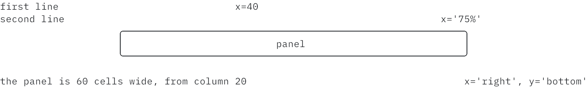
</picture>
<!-- /@code-block-asset -->

### Styling Content

All of [`ratatui`'s styling](https://ratatui.rs/examples/style/) is available in
`xnano`, as keywords of `screen.write()` (`foreground`, `background`, `bold`,
`italic`, `border`, `title`, ...) and as attributes of what it returns
(`placement.color.fg`). This includes:

- [Background & foreground colors](https://ratatui.rs/examples/style/colors/):
  names such as `'red'`, `'#rrggbb'` strings, `(red, green, blue)` tuples, the
  256 ANSI colors (`xnano.Color.indexed(208)`) and Tailwind's palette
  (`xnano.Color.from_tailwind('sky', 500)`).
- [Text modifiers](https://ratatui.rs/examples/style/modifiers/): bold, dim, italic,
  underline, blink, reverse, hidden and crossed out.
- [Borders & border styling](https://ratatui.rs/recipes/widgets/block/):
  `'plain'`, `'rounded'`, `'double'` and `'thick'` borders, with a title and a
  style of their own.

### Terminal and Terminal Devices

`xnano.open()` returns a `Terminal`: a canvas on your real screen that runs by
itself. Every canvas, live or not, has the same devices: `canvas.clock`,
`canvas.screen` and the others below (and `context.clock` and so on inside a
hook).

- `Clock`: the time of the canvas, its frame rate (`fps`) and tempo (`bpm`), and
  pausing and resuming everything that follows it.
- `Screen`: the cells the canvas draws, and `write()` to put content on them.
- `Keyboard` & `Mouse`: the key presses, pastes, clicks, drags and scrolls the canvas
  receives. They can also press keys and buttons for your program.
- `Speaker`: plays notes, melodies and sound files. <small>(Requires `xnano-audio`)</small>
- `Microphone`: the level of the sound coming in from the system's microphone.
  <small>(Requires `xnano-audio`)</small>

#### Terminal

<!-- @code-block name="terminal" type="gif" height=3
wait 0.5
press space
wait 0.2
press space
wait 2.0
press space
wait 1.3
press space
wait 5.1
press space
wait 1.0
-->
```python
import xnano

# give `xnano.open()` a `height` to draw in a region below your prompt, or leave it out
# to take over the whole window
with xnano.open(height=3, title='my app') as terminal:
    terminal.write('Welcome to xnano!', border='rounded')
    label = terminal.write('press space', x=22, y=1)

    # a hook on the terminal itself hears every event on the screen
    @terminal.hook(on='key', keys='space')
    def pressed(context: xnano.Context):
        label.text = f'space at {context.clock.elapsed_seconds:.1f}s'

    # `run()` keeps the terminal open until one of the `stop_on` keys is pressed
    terminal.run(stop_on='q')
```

<!-- @code-block-asset name="terminal" -->
<picture>
  <source media="(prefers-color-scheme: dark)" srcset="docs/assets/readme/terminal-dark.gif">
  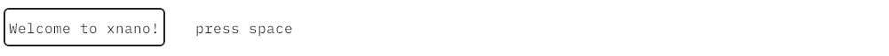
</picture>
<!-- /@code-block-asset -->

#### Clock

<!-- @code-block name="clock" type="gif" height=3
wait 4.5
press space
wait 2.5
press space
wait 4.5
-->
```python
import xnano
from xnano.expressions import ParentWidth

with xnano.open(height=3) as terminal:
    label = terminal.write('')
    ball = terminal.write('●', y=1)

    # math with the clock makes an expression, which moves the ball on every frame;
    # `ParentWidth` is the screen's width, read again when the window is resized
    ball.x = (terminal.clock * 10) % ParentWidth

    # tick hooks run on a timer, measured in seconds of the clock
    @terminal.hook(on='tick', every=1.0)
    def show_time(context: xnano.Context):
        label.text = f'{context.clock.elapsed_seconds:.0f}s on the clock'

    # `pause()` freezes everything that follows the clock, and `resume()` lets it run on
    @terminal.hook(on='key', keys='space')
    def toggle(context: xnano.Context):
        if context.clock.is_paused:
            context.clock.resume()
        else:
            context.clock.pause()
            label.text = 'paused: press space to resume'

    terminal.run(stop_on='q')
```

<!-- @code-block-asset name="clock" -->
<picture>
  <source media="(prefers-color-scheme: dark)" srcset="docs/assets/readme/clock-dark.gif">
  
</picture>
<!-- /@code-block-asset -->

#### Screen

<!-- @code-block name="screen" type="image" height=8 -->
```python
import xnano

# each service's response time, and its requests over the last 30 seconds
services = {
    'api': ('41 ms', '▂▃▃▅▃▂▃▅▆▅▃▂▃▅▆▅▃▂▂▃▅▃▂▃▅▆▅▃▂▃'),
    'web': ('870 ms', '▃▅▆▅▃▂▂▃▅▇██▇▇█▇▅▆▇██▇▆▇█▇▆▅▆▇'),
    'worker': ('12 ms', '▁▁▂▁▁▃▁▁▁▂▅▂▁▁▁▂▁▁▃▂▁▁▁▂▁▁▁▂▃▁'),
}

# a canvas from `xnano.new()` needs no live terminal: `width='100%'` fills the window
with xnano.new(width='100%', height=7) as canvas:
    screen = canvas.screen
    screen.write('services', bold=True)
    screen.write(f'{screen.width}×{screen.height} cells', x='right', y=0, dim=True)

    cards = {}
    for index, (name, (latency, graph)) in enumerate(services.items()):
        cards[name] = screen.write(
            ['● online', f'p95 {latency}', graph],
            x=f'{index * 34}%',
            y=1,
            width='32%',
            border='rounded',
            title=name,
            foreground='green',
        )

    # `write()` returns a live placement: its text and colors can change at any time
    cards['web'].text = cards['web'].text.replace('● online', '▲ slow responses')
    cards['web'].color.fg = 'yellow'

    # and they can be read back, like any other value
    healthy = sum(card.text.startswith('●') for card in cards.values())
    screen.write(f'{healthy} of {len(cards)} services healthy', y='bottom', dim=True)

    print(screen.render(format='ansi'))
```

<!-- @code-block-asset name="screen" -->
<picture>
  <source media="(prefers-color-scheme: dark)" srcset="docs/assets/readme/screen-dark.png">
  
</picture>
<!-- /@code-block-asset -->

#### Keyboard

<!-- @code-block name="keyboard" type="gif" height=8
wait 0.8
press up
wait 0.08
press up
wait 0.08
press up
wait 0.08
press up
wait 0.08
wait 0.6
press right
wait 0.08
press right
wait 0.08
press right
wait 0.08
press right
wait 0.08
press right
wait 0.08
press right
wait 0.08
press right
wait 0.08
press right
wait 0.08
press right
wait 0.08
press right
wait 0.08
press right
wait 0.08
press right
wait 0.08
press right
wait 0.08
press right
wait 0.08
press right
wait 0.08
press right
wait 0.08
press right
wait 0.08
press right
wait 0.08
press right
wait 0.08
press right
wait 0.08
wait 0.6
press down
wait 0.08
press down
wait 0.08
press down
wait 0.08
wait 0.6
press left
wait 0.08
press left
wait 0.08
press left
wait 0.08
press left
wait 0.08
press left
wait 0.08
wait 0.6
press ctrl+r
wait 1.2
-->
```python
import xnano

# `edges='stop'` keeps content inside the terminal when it moves
with xnano.open(height=8, edges='stop') as terminal:
    player = terminal.write('@', x='center', y='center')
    terminal.write(
        'arrows or wasd to move · ctrl+r to reset · q to quit', y='bottom', dim=True
    )

    # `on='key'` hooks run on every key press, and again while a key repeats
    @terminal.hook(on='key')
    def move(context: xnano.Context):
        # `direction()` reads the arrow keys (or wasd) as one step along each axis
        step_x, step_y = context.keyboard.direction()
        player.move(step_x, step_y)

    # `keys=` narrows a hook to one key, or to a binding with modifiers
    @terminal.hook(on='key', keys='ctrl+r')
    def reset(context: xnano.Context):
        player.x, player.y = 'center', 'center'

    terminal.run(stop_on='q')
```

<!-- @code-block-asset name="keyboard" -->
<picture>
  <source media="(prefers-color-scheme: dark)" srcset="docs/assets/readme/keyboard-dark.gif">
  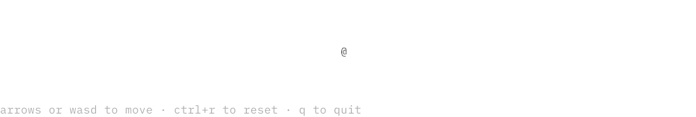
</picture>
<!-- /@code-block-asset -->

#### Mouse

<!-- @code-block name="mouse" type="gif" height=3
wait 0.8
drag 0 1 22 1
wait 1.2
drag 22 1 9 1
wait 1.5
-->
```python
import xnano

# `mouse=True` turns on mouse events
with xnano.open(height=3, mouse=True) as terminal:
    terminal.write('─' * 30, y=1)
    label = terminal.write('drag the ●', y=2)

    # a range keeps the thumb's `x` between two columns, however far it is dragged
    thumb = terminal.write('●', x=(0, 29), y=1)

    # a drag hook is a generator: each `yield` waits for the next movement of the pointer
    @thumb.hook(on='drag')
    def slide(context: xnano.Context):
        while context.mouse.is_down:
            thumb.x = context.parent.local(context.mouse.position).x
            context = yield
        label.text = f'dropped at {thumb.x}'

    terminal.run(stop_on='q')
```

<!-- @code-block-asset name="mouse" -->
<picture>
  <source media="(prefers-color-scheme: dark)" srcset="docs/assets/readme/mouse-dark.gif">
  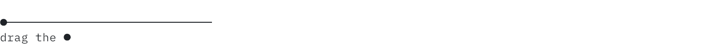
</picture>
<!-- /@code-block-asset -->

#### Speaker (Audio & Virtual Instruments)

Notes and melodies are plain values. A live terminal plays them through its
speaker, and outside one, `xnano.play()` plays them through your computer's
sound output.

<!-- @code-block name="speaker" type="gif" height=3
wait 2.2
press 1
wait 0.5
press 3
wait 0.5
press 5
wait 0.5
press space
wait 1.8
-->
```python
import xnano

scale = ['C4', 'D4', 'E4', 'G4', 'A4']
chord = xnano.Note(('C4', 'E4', 'G4'), beats=2, instrument='electric_piano')

with xnano.open(height=2) as terminal:
    terminal.write('press 1-5 for a note, space for a chord')
    playing = terminal.write('', y=1, foreground='cyan')

    @terminal.hook(on='key')
    def play_note(context: xnano.Context):
        key = context.keyboard.key
        if key in ('1', '2', '3', '4', '5'):
            pitch = scale[int(key) - 1]
            playing.text = f'♪ {pitch}'
            note = xnano.Note(pitch, beats=0.5)
        elif key == 'space':
            playing.text = '♪ C4 E4 G4'
            note = chord
        else:
            return
        # a computer without a sound output device (over SSH, for example) only shows it
        if context.speaker.is_available:
            context.speaker.play(note)

    # a melody can also be written as text: a pitch, and its length in beats after a `:`
    if terminal.speaker.is_available:
        terminal.speaker.play('C4 E4 G4:2', instrument='piano')
    terminal.run(stop_on='q')
```

<!-- @code-block-asset name="speaker" -->
<picture>
  <source media="(prefers-color-scheme: dark)" srcset="docs/assets/readme/speaker-dark.gif">
  
</picture>
<!-- /@code-block-asset -->

#### Microphone

<!-- @code-block name="microphone" type="image" height=3
wait 1.5
-->
```python
import xnano

with xnano.open(height=2) as terminal:
    terminal.write('speak into your microphone')

    # `level` is an expression from 0.0 to 1.0, so content can follow it on every frame
    # (the default input device opens the first time a frame reads it)
    level = terminal.microphone.level
    terminal.write('░' * 40, x=0, y=1, dim=True)
    terminal.write(
        '█' * 40, x=0, y=1, width=level * 40 + 1, foreground='green', layer=1
    )

    terminal.run(stop_on='q')
```

<!-- @code-block-asset name="microphone" -->
<picture>
  <source media="(prefers-color-scheme: dark)" srcset="docs/assets/readme/microphone-dark.png">
  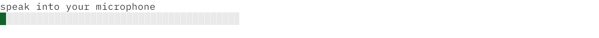
</picture>
<!-- /@code-block-asset -->

### Built-in terminal widgets (from `ratatui`)

All of [`ratatui`'s built-in widgets](https://ratatui.rs/concepts/widgets/) are
in `xnano.widgets`, where ratatui's `List` is `ItemList` and its `Canvas` is
`Figure`. A widget is written, sized and bordered like any other content. Each
widget below links to the `ratatui` widget that it draws with.

#### Bar Chart

Maps to [`ratatui::widgets::BarChart`](https://docs.rs/ratatui/0.30.0/ratatui/widgets/struct.BarChart.html).

<!-- @code-block name="widget-bar-chart" type="image" height=9 -->
```python
import xnano
from xnano.styles import Style
from xnano.widgets import Bar, BarChart

chart = BarChart(
    [Bar(73, label='cpu'), Bar(41, label='memory'), Bar(18, label='network')],
    bar_width=8,
    bar_gap=3,
    bar_style=Style(foreground='magenta'),
)

with xnano.new(width=40, height=8) as canvas:
    canvas.write(chart, width='100%', height='100%', border='rounded', title='load')
    print(canvas.render(format='ansi'))
```

<!-- @code-block-asset name="widget-bar-chart" -->
<picture>
  <source media="(prefers-color-scheme: dark)" srcset="docs/assets/readme/widget-bar-chart-dark.png">
  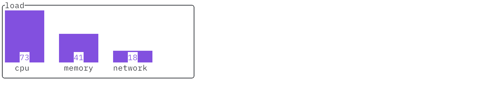
</picture>
<!-- /@code-block-asset -->

#### Block

Maps to [`ratatui::widgets::Block`](https://docs.rs/ratatui/0.30.0/ratatui/widgets/struct.Block.html).

<!-- @code-block name="widget-block" type="image" height=5 -->
```python
import xnano
from xnano.styles import Style
from xnano.widgets import Block

# a block is a border and a title; content written inside it is drawn on top
block = Block('status', border_type='double', border_style=Style(foreground='cyan'))

with xnano.new(width=40, height=4) as canvas:
    canvas.write(block, width='100%', height='100%')
    canvas.write('all services online', x=2, y=1, foreground='green')
    print(canvas.render(format='ansi'))
```

<!-- @code-block-asset name="widget-block" -->
<picture>
  <source media="(prefers-color-scheme: dark)" srcset="docs/assets/readme/widget-block-dark.png">
  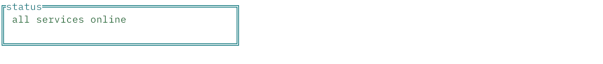
</picture>
<!-- /@code-block-asset -->

#### Calendar

Maps to [`ratatui::widgets::calendar::Monthly`](https://docs.rs/ratatui/0.30.0/ratatui/widgets/calendar/struct.Monthly.html).

<!-- @code-block name="widget-calendar" type="image" height=10 -->
```python
import xnano
from xnano.styles import Style
from xnano.widgets import Calendar

month = Calendar(2026, 11, month_header_style=Style(bold=True))

with xnano.new(width=24, height=9) as canvas:
    canvas.write(month, width='100%', height='100%', border='rounded')
    print(canvas.render(format='ansi'))
```

<!-- @code-block-asset name="widget-calendar" -->
<picture>
  <source media="(prefers-color-scheme: dark)" srcset="docs/assets/readme/widget-calendar-dark.png">
  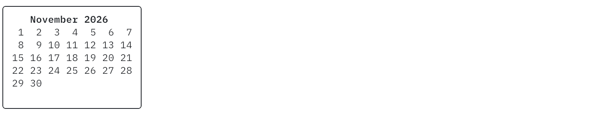
</picture>
<!-- /@code-block-asset -->

#### Chart

Maps to [`ratatui::widgets::Chart`](https://docs.rs/ratatui/0.30.0/ratatui/widgets/struct.Chart.html).

<!-- @code-block name="widget-chart" type="image" height=11 -->
```python
import math

import xnano
from xnano.styles import Style
from xnano.widgets import Chart, ChartAxis, ChartDataset

wave = [(step / 4, math.sin(step / 4)) for step in range(50)]
chart = Chart(
    [
        ChartDataset(
            name='sin',
            data=wave,
            marker='braille',
            graph_type='line',
            style=Style(foreground='cyan'),
        )
    ],
    x_axis=ChartAxis(bounds=(0, 12), labels=['0', '6', '12']),
    y_axis=ChartAxis(bounds=(-1, 1), labels=['-1', '0', '1']),
)

with xnano.new(width=40, height=10) as canvas:
    canvas.write(chart, width='100%', height='100%', border='rounded', title='wave')
    print(canvas.render(format='ansi'))
```

<!-- @code-block-asset name="widget-chart" -->
<picture>
  <source media="(prefers-color-scheme: dark)" srcset="docs/assets/readme/widget-chart-dark.png">
  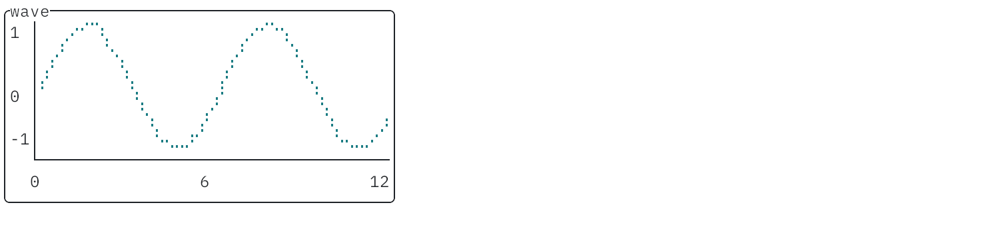
</picture>
<!-- /@code-block-asset -->

#### Figure

Maps to [`ratatui::widgets::canvas::Canvas`](https://docs.rs/ratatui/0.30.0/ratatui/widgets/canvas/struct.Canvas.html).

<!-- @code-block name="widget-figure" type="image" height=11 -->
```python
import xnano
from xnano.widgets import Figure, FigureCircle, FigureLine

# a figure draws shapes in its own coordinates, here 0 to 100 on each axis
figure = Figure((0, 100), (0, 100), marker='braille')
figure.add_shape(FigureCircle(50, 50, 40, 'yellow'))
figure.add_shape(FigureLine(10, 10, 90, 90, 'cyan'))

with xnano.new(width=40, height=10) as canvas:
    canvas.write(figure, width='100%', height='100%', border='rounded', title='figure')
    print(canvas.render(format='ansi'))
```

<!-- @code-block-asset name="widget-figure" -->
<picture>
  <source media="(prefers-color-scheme: dark)" srcset="docs/assets/readme/widget-figure-dark.png">
  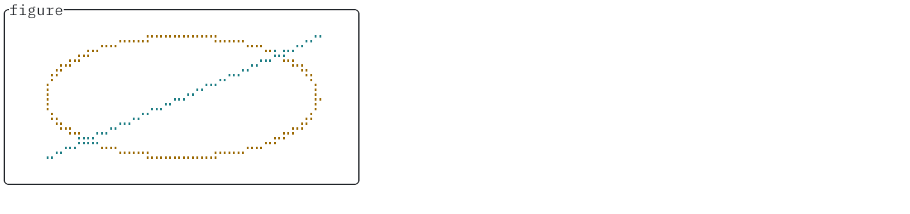
</picture>
<!-- /@code-block-asset -->

#### Gauge

Maps to [`ratatui::widgets::Gauge`](https://docs.rs/ratatui/0.30.0/ratatui/widgets/struct.Gauge.html).

<!-- @code-block name="widget-gauge" type="image" height=4 -->
```python
import xnano
from xnano.styles import Style
from xnano.widgets import Gauge

gauge = Gauge(0.6, label='60% of 512 GB', gauge_style=Style(foreground='green'))

with xnano.new(width=40, height=3) as canvas:
    canvas.write(gauge, width='100%', height='100%', border='rounded', title='disk')
    print(canvas.render(format='ansi'))
```

<!-- @code-block-asset name="widget-gauge" -->
<picture>
  <source media="(prefers-color-scheme: dark)" srcset="docs/assets/readme/widget-gauge-dark.png">
  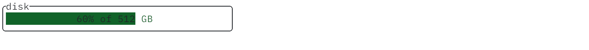
</picture>
<!-- /@code-block-asset -->

#### Item List

Maps to [`ratatui::widgets::List`](https://docs.rs/ratatui/0.30.0/ratatui/widgets/struct.List.html).

<!-- @code-block name="widget-item-list" type="image" height=7 -->
```python
import xnano
from xnano.styles import Style
from xnano.widgets import ItemList

# ratatui's `List` is `ItemList` in xnano
items = ItemList(
    ['inbox', 'drafts', 'sent', 'archive'],
    selected=1,
    highlight_symbol='> ',
    highlight_style=Style(foreground='black', background='cyan'),
)

with xnano.new(width=40, height=6) as canvas:
    canvas.write(items, width='100%', height='100%', border='rounded', title='folders')
    print(canvas.render(format='ansi'))
```

<!-- @code-block-asset name="widget-item-list" -->
<picture>
  <source media="(prefers-color-scheme: dark)" srcset="docs/assets/readme/widget-item-list-dark.png">
  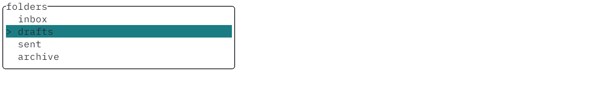
</picture>
<!-- /@code-block-asset -->

#### Line Gauge

Maps to [`ratatui::widgets::LineGauge`](https://docs.rs/ratatui/0.30.0/ratatui/widgets/struct.LineGauge.html).

<!-- @code-block name="widget-line-gauge" type="image" height=4 -->
```python
import xnano
from xnano.styles import Style
from xnano.widgets import LineGauge

gauge = LineGauge(0.8, label='upload', filled_style=Style(foreground='magenta'))

with xnano.new(width=40, height=3) as canvas:
    canvas.write(gauge, width='100%', height='100%', border='rounded')
    print(canvas.render(format='ansi'))
```

<!-- @code-block-asset name="widget-line-gauge" -->
<picture>
  <source media="(prefers-color-scheme: dark)" srcset="docs/assets/readme/widget-line-gauge-dark.png">
  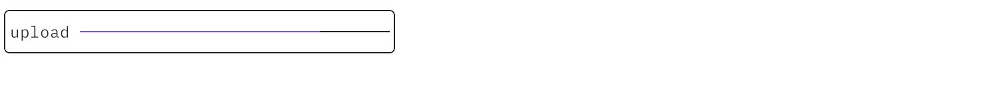
</picture>
<!-- /@code-block-asset -->

#### Paragraph

Maps to [`ratatui::widgets::Paragraph`](https://docs.rs/ratatui/0.30.0/ratatui/widgets/struct.Paragraph.html).

<!-- @code-block name="widget-paragraph" type="image" height=7 -->
```python
import xnano
from xnano.widgets import Paragraph

text = (
    'A paragraph wraps its text at the width it is given, and can align it to the '
    'left, the center or the right.'
)

with xnano.new(width=40, height=6) as canvas:
    canvas.write(
        Paragraph(text, should_wrap=True, alignment='center'),
        width='100%',
        height='100%',
        border='rounded',
        title='paragraph',
    )
    print(canvas.render(format='ansi'))
```

<!-- @code-block-asset name="widget-paragraph" -->
<picture>
  <source media="(prefers-color-scheme: dark)" srcset="docs/assets/readme/widget-paragraph-dark.png">
  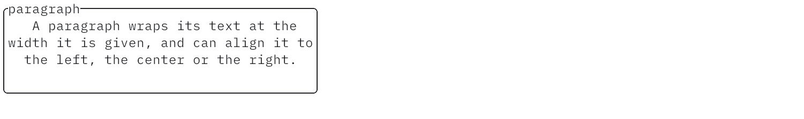
</picture>
<!-- /@code-block-asset -->

#### Scrollbar

Maps to [`ratatui::widgets::Scrollbar`](https://docs.rs/ratatui/0.30.0/ratatui/widgets/struct.Scrollbar.html).

<!-- @code-block name="widget-scrollbar" type="image" height=7 -->
```python
import xnano
from xnano.widgets import Scrollbar

lines = [f'line {number}' for number in range(1, 31)]

with xnano.new(width=40, height=6) as canvas:
    canvas.write('\n'.join(lines[10:16]))
    # 30 lines of content, 6 of them in view, scrolled to line 11
    canvas.write(
        Scrollbar(30, 10, viewport_content_length=6, orientation='vertical_right'),
        x='right',
        y=0,
        width=1,
        height='100%',
    )
    print(canvas.render(format='ansi'))
```

<!-- @code-block-asset name="widget-scrollbar" -->
<picture>
  <source media="(prefers-color-scheme: dark)" srcset="docs/assets/readme/widget-scrollbar-dark.png">
  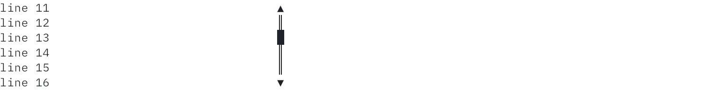
</picture>
<!-- /@code-block-asset -->

#### Sparkline

Maps to [`ratatui::widgets::Sparkline`](https://docs.rs/ratatui/0.30.0/ratatui/widgets/struct.Sparkline.html).

<!-- @code-block name="widget-sparkline" type="image" height=6 -->
```python
import math

import xnano
from xnano.styles import Style
from xnano.widgets import Sparkline

requests = [round(6 + 3 * math.sin(second / 4)) for second in range(38)]

with xnano.new(width=40, height=5) as canvas:
    canvas.write(
        Sparkline(requests, style=Style(foreground='cyan')),
        width='100%',
        height='100%',
        border='rounded',
        title='requests',
    )
    print(canvas.render(format='ansi'))
```

<!-- @code-block-asset name="widget-sparkline" -->
<picture>
  <source media="(prefers-color-scheme: dark)" srcset="docs/assets/readme/widget-sparkline-dark.png">
  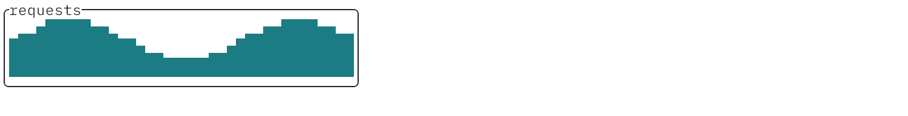
</picture>
<!-- /@code-block-asset -->

#### Table

Maps to [`ratatui::widgets::Table`](https://docs.rs/ratatui/0.30.0/ratatui/widgets/struct.Table.html).

<!-- @code-block name="widget-table" type="image" height=7 -->
```python
import xnano
from xnano.styles import Style
from xnano.widgets import Table, TableCell, TableRow

table = Table(
    [
        ['web', 'up', '41 ms'],
        ['api', 'up', '12 ms'],
        ['db', TableCell('down', style=Style(foreground='red')), '—'],
    ],
    header=TableRow(['service', 'status', 'p95'], style=Style(bold=True)),
)

with xnano.new(width=40, height=6) as canvas:
    canvas.write(table, width='100%', height='100%', border='rounded', title='services')
    print(canvas.render(format='ansi'))
```

<!-- @code-block-asset name="widget-table" -->
<picture>
  <source media="(prefers-color-scheme: dark)" srcset="docs/assets/readme/widget-table-dark.png">
  
</picture>
<!-- /@code-block-asset -->

#### Tabs

Maps to [`ratatui::widgets::Tabs`](https://docs.rs/ratatui/0.30.0/ratatui/widgets/struct.Tabs.html).

<!-- @code-block name="widget-tabs" type="image" height=4 -->
```python
import xnano
from xnano.styles import Style
from xnano.widgets import Tabs

tabs = Tabs(
    ['overview', 'logs', 'settings'],
    selected=1,
    highlight_style=Style(foreground='cyan', bold=True),
)

with xnano.new(width=40, height=3) as canvas:
    canvas.write(tabs, width='100%', height='100%', border='rounded')
    print(canvas.render(format='ansi'))
```

<!-- @code-block-asset name="widget-tabs" -->
<picture>
  <source media="(prefers-color-scheme: dark)" srcset="docs/assets/readme/widget-tabs-dark.png">
  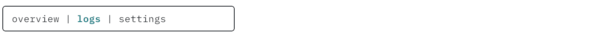
</picture>
<!-- /@code-block-asset -->

### Images & Pixel Art

Pixel art is written as text in your code with `xnano.pixel_art()`. Pictures are
loaded from files with `xnano.load_image()`, from the `xnano-image` package
(built on [`ratatui-image`](https://github.com/ratatui/ratatui-image)).

#### Pixel Art

<!-- @code-block name="pixel-art" type="image" height=6 -->
```python
import xnano

# each character is one pixel: the palette names the colors, and `.` is see-through
heart = xnano.pixel_art(
    """
    ..RR...RR..
    .RWWR.RRRR.
    RRWRRRRRRRR
    RRRRRRRRRRR
    .RRRRRRRRR.
    ..RRRRRRR..
    ...RRRRR...
    ....RRR....
    .....R.....
    """,
    'R=#e03040 W=#ffffff',
)

# two pixels fit in one cell, one above the other, so the heart takes 11 by 5 cells
print(xnano.region(heart).render(format='ansi'))
```

<!-- @code-block-asset name="pixel-art" -->
<picture>
  <source media="(prefers-color-scheme: dark)" srcset="docs/assets/readme/pixel-art-dark.png">
  
</picture>
<!-- /@code-block-asset -->

#### Images

Images need the `image` extra:

```bash
pip install "xnano[image]"
```

A picture can be loaded and printed without opening a live terminal:

<!-- @code-block name="images" type="image" height=31 -->
```python
import pathlib

import xnano

# this picture ships with xnano, so the example runs anywhere: use any path of your own
path = pathlib.Path(xnano.__file__).parent / 'assets' / 'dusk.png'

# `.png`, `.jpg`, `.webp` and animated `.gif` files load, sized in cells or a percentage
picture = xnano.load_image(path, width='100%')

# `xnano.region()` draws content into cells without a terminal, so it can be printed
print(xnano.region(picture).render(format='ansi'))
```

<!-- @code-block-asset name="images" -->
<picture>
  <source media="(prefers-color-scheme: dark)" srcset="docs/assets/readme/images-dark.png">
  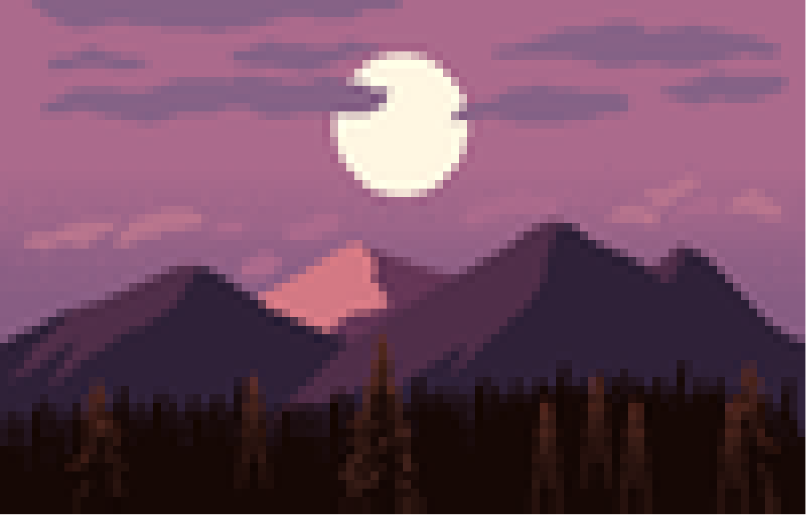
</picture>
<!-- /@code-block-asset -->

### Animations

Every placement has `fx`, with one method for each effect of
[`tachyonfx`](https://github.com/ratatui/tachyonfx): fades, sweeps, slides,
dissolves, hue shifts and more. Call a method to start its effect, and
`terminal.fx` starts one on the whole screen. To move content instead, give its
position an expression of the clock, as the **Clock** example does.

<!-- @code-block name="animations" type="gif" height=6
wait 1.2
press 1
wait 1.2
press 2
wait 1.2
press 3
wait 1.4
-->
```python
import xnano

with xnano.open(height=6) as terminal:
    card = terminal.write(
        'xnano',
        border='rounded',
        padding={'horizontal': 4, 'vertical': 1},
        foreground='magenta',
    )
    terminal.write('1 sweep · 2 slide · 3 hue · q quit', y='bottom', dim=True)

    # every placement has `fx`, with one method for each effect: this one fades the card in
    card.fx.fade_from(foreground='black', duration_milliseconds=800)

    @terminal.hook(on='key', keys='1')
    def sweep(context: xnano.Context):
        card.fx.sweep_in(color='cyan', duration_milliseconds=600)

    @terminal.hook(on='key', keys='2')
    def slide(context: xnano.Context):
        card.fx.slide_in(direction='left_to_right', duration_milliseconds=600)

    @terminal.hook(on='key', keys='3')
    def hue(context: xnano.Context):
        card.fx.hsl_shift(foreground=(180, 0, 0), duration_milliseconds=900)

    terminal.run(stop_on='q')
```

<!-- @code-block-asset name="animations" -->
<picture>
  <source media="(prefers-color-scheme: dark)" srcset="docs/assets/readme/animations-dark.gif">
  
</picture>
<!-- /@code-block-asset -->

### AI

`xnano.ai` puts language models and decision models to work on a canvas: they read
what is on the screen, and answer in `xnano` values, such as text, a choice, pixel
art or a melody. It needs the `ai` extra and Python 3.11 or newer:

```bash
pip install "xnano[ai]"
```

#### Streaming Text

A `TextModel` writes prose, and `stream_into_async()` shows it in a placement as
the model writes it.

```python
import xnano
from xnano.ai import TextModel, stream_into_async

# any pydantic-ai model works: this one reads the ANTHROPIC_API_KEY environment variable
narrator = TextModel(
    'anthropic:claude-sonnet-5-5', style='eerie, second person', max_sentences=2
)

with xnano.open(height=5) as terminal:
    story = terminal.write('press enter to begin', width='100%', edges='wrap')
    terminal.write('enter: next moment · q: quit', y='bottom', dim=True)

    # an `async def` hook waits for the model without stopping the terminal, and the
    # text appears in the placement as the model writes it
    @terminal.hook(on='key', keys='enter')
    async def narrate(context: xnano.Context):
        request = 'Tell the next moment of a ghost story set in a lighthouse.'
        await stream_into_async(story, narrator.stream_async(request))

    terminal.run(stop_on='q')
```

#### Making Decisions

A `ChoiceModel` picks one of the options that you give it, for the facts that you
give it.

```python
import xnano
from xnano.ai import ChoiceModel

# a choice model picks one of the options you give it, for what happens on the canvas
guard_mind = ChoiceModel('anthropic:claude-sonnet-5-5')
actions = {'1': 'bows politely', '2': 'shouts at the guard', '3': 'offers a gold coin'}

with xnano.open(height=3) as terminal:
    guard = terminal.write('the guard watches you', foreground='yellow')
    terminal.write('1 bow · 2 shout · 3 offer gold · q quit', y='bottom', dim=True)

    @terminal.hook(on='key', keys=['1', '2', '3'])
    async def react(context: xnano.Context):
        decision = await guard_mind.choose_async(
            {'the player': actions[context.keyboard.key]},
            {
                'welcome': 'the guard lets the player pass',
                'block': 'the guard blocks the way',
                'arrest': 'the guard calls for help',
            },
            question='How does the guard react to the player?',
        )
        guard.text = f'the guard decides: {decision.choice}'

    terminal.run(stop_on='q')
```

## `rich` and `textual` users

One of the biggest goals I've had with `xnano` has been to ensure it never gets
in the way of what the [`Textualize`](https://textualize.io/) ecosystem has been
building for years. From version `2.2.1` onwards, `xnano` works with both
[`rich`](https://github.com/Textualize/rich) and
[`textual`](https://github.com/Textualize/textual), in both directions:

- **Into `xnano`**: `xnano.from_rich()` writes any `rich` renderable, or `rich`
  markup, in a canvas. `StyledText.from_ansi()` writes text with ANSI color codes,
  such as the output of a command.
- **Out of `xnano`**: canvases, screens, placements and regions follow `rich`'s
  [console protocol](https://rich.readthedocs.io/en/latest/protocol.html), so
  `rich.print()`, a `rich` `Panel` or `Table`, and a `textual` `Static` show them
  as they are. In a `rich` `Table`, add the column with `no_wrap=True` to keep a
  canvas whole when the table is narrow.

### `rich`

<!-- @code-block name="rich-console" type="image" height=9 -->
```python
import xnano
from rich import print
from rich.table import Table
from xnano.styles import StyledText

table = Table('service', 'status')
table.add_row('web', '[green]● up[/green]')
table.add_row('db', '[red]▲ slow[/red]')

with xnano.new(width=40, height=8) as canvas:
    # rich renderables and rich markup go into a canvas with `xnano.from_rich()`
    canvas.write(xnano.from_rich(table))
    canvas.write(xnano.from_rich('[bold green]✓[/] build passed'), y=6)

    # text with ANSI color codes, such as the output of a command, goes in the same way
    log_line = StyledText.from_ansi('\x1b[2m12:00:01\x1b[0m deploy started')
    canvas.write(log_line, y='bottom')

    # and the canvas goes back to rich as it is
    print(canvas)
```

<!-- @code-block-asset name="rich-console" -->
<picture>
  <source media="(prefers-color-scheme: dark)" srcset="docs/assets/readme/rich-console-dark.png">
  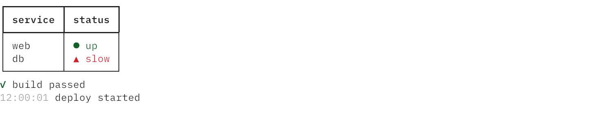
</picture>
<!-- /@code-block-asset -->

### `textual`

A `textual` `Static` shows an `xnano` canvas as it is, and `xnano`'s hooks can handle
`textual`'s keys: pass each key to the canvas with `push()` and `deliver_events()`.
Make the canvas with `xnano.new()` outside a `with` block, so it stays open:
`textual` draws the `Static` after it is made.

<!-- @code-block name="textual" type="gif" height=5
wait 2.5
press space
wait 0.5
press space
wait 0.5
press space
wait 1.2
press r
wait 1.2
-->
```python
import xnano
from textual import events
from textual.app import App, ComposeResult
from textual.widgets import Static
from xnano.events import Event


class Counter(App):
    BINDINGS = [('q', 'quit', 'Quit')]

    def compose(self) -> ComposeResult:
        # an xnano canvas is a rich renderable, so a textual `Static` shows it as it is
        self.canvas = xnano.new(width=32, height=4)
        yield Static(self.canvas)

    def on_mount(self) -> None:
        counter = self.canvas.write('presses: 0', border='rounded')
        self.canvas.write('space +1 · r reset · q quit', dim=True)
        self.presses = 0

        # xnano hooks change the canvas
        @self.canvas.hook(on='key', keys=['space', 'r'])
        def count(context: xnano.Context) -> None:
            is_space = context.keyboard.key == 'space'
            self.presses = self.presses + 1 if is_space else 0
            counter.text = f'presses: {self.presses}'

    def on_key(self, event: events.Key) -> None:
        # pass textual's keys to the xnano hooks, then show the canvas again
        self.canvas.push(Event.key_press(event.key))
        self.canvas.deliver_events()
        self.query_one(Static).update(self.canvas)


if __name__ == '__main__':
    Counter().run()
```

<!-- @code-block-asset name="textual" -->
<picture>
  <source media="(prefers-color-scheme: dark)" srcset="docs/assets/readme/textual-dark.gif">
  
</picture>
<!-- /@code-block-asset -->

## Learn More

- [Documentation](https://xnano.hammad.app): the documentation site.
- [Learn](https://xnano.hammad.app/learn/): a step-by-step introduction.
- [API Reference](https://xnano.hammad.app/api-reference/): every public module,
  class and function.
- [Contribution Guide](./CONTRIBUTING.md): how to set up the development
  workspace, make changes and open a pull request.

`xnano` is released under the [MIT License](./LICENSE).
