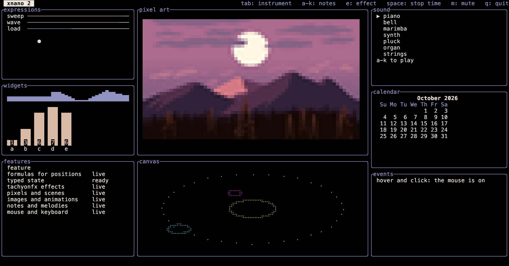
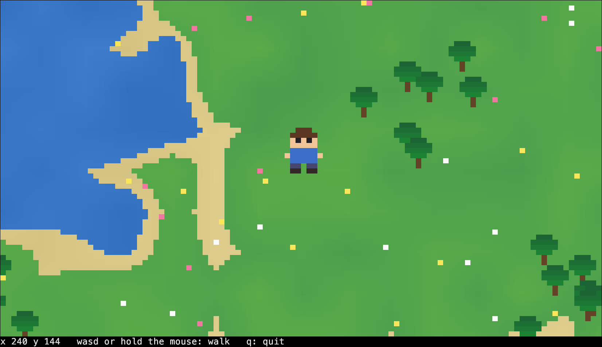
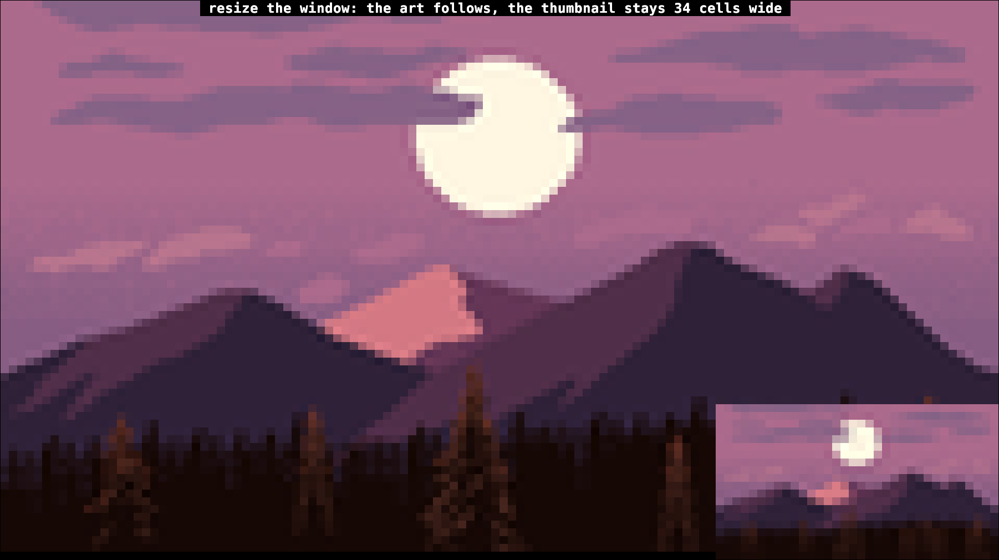
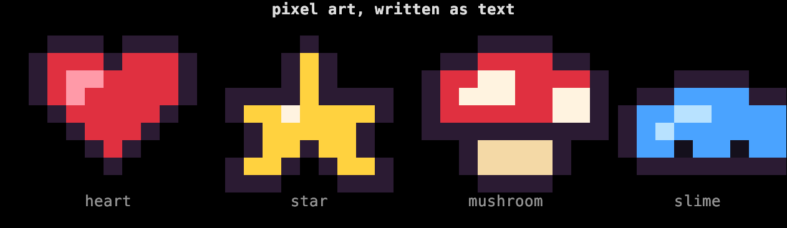
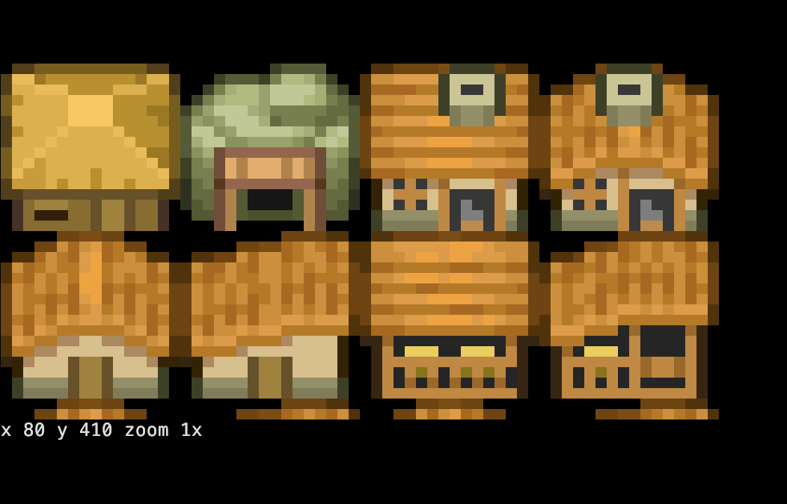
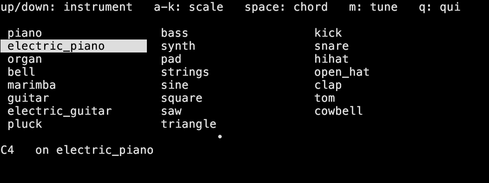
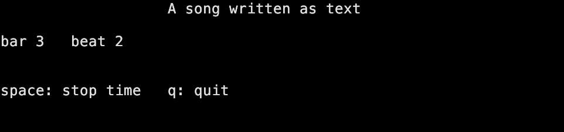
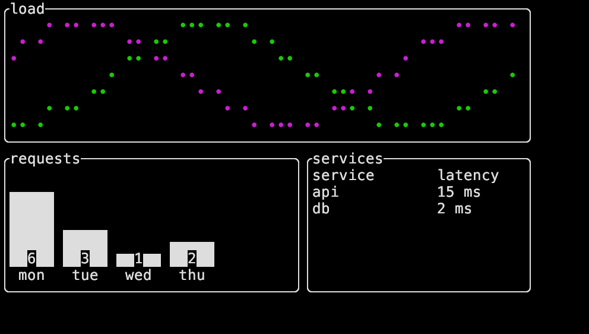

> [!NOTE]
> This is xnano v2, a terminal you put things on. Looking for the grid-and-field API of v1? It lives on the
> [`v1` branch](https://github.com/hsaeed3/xnano/tree/v1); install the latest release,
> [v1.2.3](https://github.com/hsaeed3/xnano/releases/tag/xnano%2Fv1.2.3), with `pip install "xnano>=1.2.3,<2"`.

<div align="center">

# **xnano**

**A fun, fast and incredibly flexible terminal UI library for Python, built on [`ratatui`](https://ratatui.rs).**


[](https://app.codspeed.io/hsaeed3/xnano?utm_source=badge)
[](https://ratatui.rs/)

[Documentation](https://xnano.hammad.app) · [API Reference](https://xnano.hammad.app/api-reference/) · [Contributing](./CONTRIBUTING.md)

</div>

---

## Quick start

```python
import xnano
from xnano.context import Context
from xnano.expressions import ParentWidth, TimeElapsed, Width

with xnano.open(width=40, height=5) as terminal:
    terminal.write('Hello, world!', x='center', border='rounded')
    ball = terminal.write('●', y=4)
    ball.x = (ParentWidth - Width) * (TimeElapsed % 2 / 2)  # a formula, evaluated every frame

    @terminal.on_key('space')
    def toggle(context: Context) -> None:
        if terminal.is_paused:
            terminal.resume()
        else:
            terminal.pause()

    terminal.run(quit_on='q')
```

`xnano.open()` gives you a terminal. You `write` text, widgets, images and pixels to it, and every
position and size can be a number, a word such as `'center'`, or a formula of time or of the
terminal's size. Decorators named for what happens (`on_key`, `on_click`, `every`, `after`)
react, `terminal.input` tells a game which keys are held, `terminal.scene()` gives pixel-art
worlds a camera and collision, and `terminal.play('C4 E4 G4:2')` plays a melody written as text.
There are no base classes to subclass and no layout tree to declare.

The [`examples/`](./examples) folder has twenty-one runnable programs, from hello world to a
playable pixel-art world, and `examples/README.md` shows what each one draws.

## See it

Run the demo in your terminal with `python -m xnano` (or the `xnano` command). It opens with an
animation, then fills the window with live panels that each use a different part of xnano.



Every picture below is a real terminal window running one of the programs in
[`examples/`](./examples), photographed by `make readme-images`, so each picture and its
source stay in step.

### A playable world

A pixel-art character, a camera that follows it, collision and a clock you can stop: about
one screen of code ([`20_world.py`](./examples/20_world.py)).



### Pixel art that fits the window

Give an image a percentage and it refits whenever the window is resized, keeping its hard pixel
edges; give it a number and it is locked. The thumbnail in the corner is locked
([`24_dusk.py`](./examples/24_dusk.py)). The art is "Mountain at Dusk" by Luis Zuno (ansimuz), CC0.



### Pixel art written as text

`from_art` turns a block of characters and a short palette into an image
([`23_sprites.py`](./examples/23_sprites.py)).



### Images and animations

Pan and zoom over a large picture with the arrow keys and `+` / `-`
([`06_images.py`](./examples/06_images.py)).



### Sound

Every built-in instrument, playable from the keyboard ([`10_audio.py`](./examples/10_audio.py)),
and a whole song written as text, played on the beat ([`22_song.py`](./examples/22_song.py)).




### Widgets

Charts, tables and gauges refreshed from a timer ([`14_dashboard.py`](./examples/14_dashboard.py)).



## Install

Install `xnano` with pip or uv. Sound and images are extras, so a program that needs neither
installs neither:

```bash
pip install xnano                # the terminal, widgets, effects and events
pip install "xnano[audio]"       # adds notes, melodies, sounds and the microphone
pip install "xnano[image]"       # adds images and animations
pip install "xnano[audio,image]"
# or
uv add "xnano[audio,image]"
```

Using sound or images without their extra raises an `ImportError` that names the extra to
install. On Linux, audio device playback requires ALSA; synthesis and melody scheduling work
without an audio device.

## Packages

The repository is a uv workspace with three installable backends and a small `xnano`
metapackage that holds the terminal API. The backends can also be installed on their own.

| Distribution | Import | Purpose |
| --- | --- | --- |
| [`xnano`](.) | `xnano` | The terminal API: `open`, placements, hooks, input, pixels, scenes and sound. |
| [`xnano-core`](./packages/xnano-core) | `xnano_core` | The Rust-backed engine: buffers, widgets, layout, state, input, runtime and effects. |
| [`xnano-audio`](./packages/xnano-audio) | `xnano_audio` | Audio synthesis, playback, capture and beat-based melodies. |
| [`xnano-image`](./packages/xnano-image) | `xnano_image` | Image and animation decoding, processing and terminal-cell conversion. |

Names live in modules named for what they hold, so the top-level `xnano` stays small:
`xnano.widgets`, `xnano.expressions`, `xnano.effects`, `xnano.operations`, `xnano.styles`,
`xnano.events`, `xnano.geometry`, `xnano.buffers`, `xnano.scene`, `xnano.types` and
`xnano.errors`, plus the optional `xnano.audio` and `xnano.image`.

## xnano v1

xnano v1 (the declarative grid-and-field API) is not part of this branch. It is maintained on
the [`v1` branch](https://github.com/hsaeed3/xnano/tree/v1), and the latest release is
[v1.2.3](https://github.com/hsaeed3/xnano/releases/tag/xnano%2Fv1.2.3)
([PyPI](https://pypi.org/project/xnano/1.2.3/)):

```bash
pip install "xnano>=1.2.3,<2"
```

The v1 guides are kept in [`docs/v1`](./docs/v1/), and their code imports from `xnano`, as v1
did. A program written for v1 must be rewritten for v2.

## Development

The repository uses a uv workspace and Rust workspace. From the repository root, `uv sync --all-extras`
installs the development environment and `make help` lists common build, test, lint, type-check,
docs and release commands. Read [CONTRIBUTING.md](./CONTRIBUTING.md) before opening a change.

## License

xnano is released under the [MIT License](./LICENSE).
